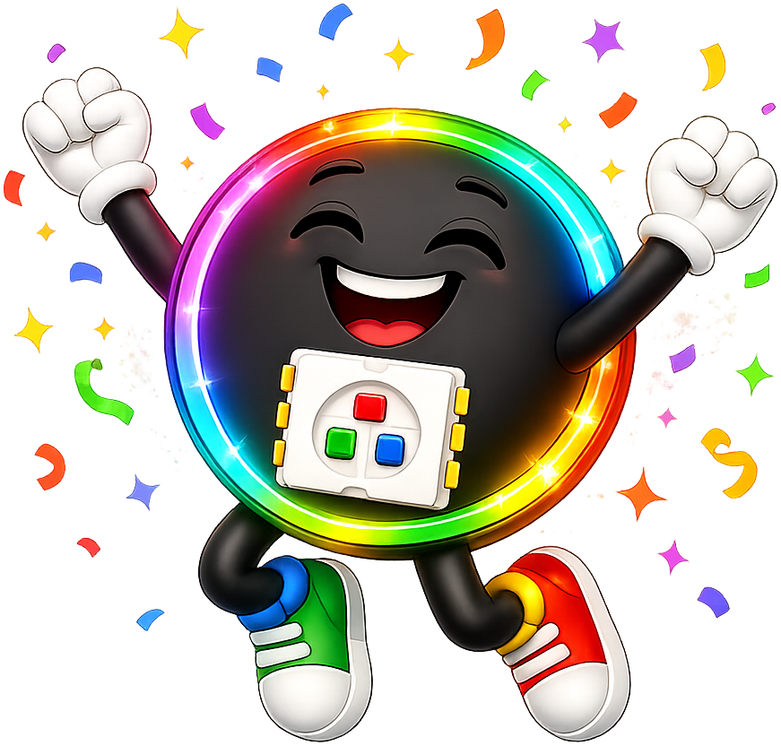

# Lab 7: Pumpkin Glow

The whole strip glows orange and slowly gets brighter and dimmer, like a jack-o'-lantern breathing in the dark.

!!! tip "Pixel says..."
    
    Pumpkins are the stars of Halloween. Let's make your costume glow like one!

**Program file:** [`07-pumpkin-glow.py`](https://github.com/dmccreary/moving-rainbow/blob/master/src/kits/halloween-60-button/07-pumpkin-glow.py)

## What You'll Learn

- Use `strip.fill()` to color every pixel at once
- Count up and then down with two loops
- Use `range()` with a step size

## What You'll Need

- Your costume with the strip connected

## The Program

This program fades the whole strip up and down in orange.

```python
--8<-- "src/kits/halloween-60-button/07-pumpkin-glow.py"
```

You should see the strip slowly glow brighter, then dimmer, but never go fully dark.

## How It Works

`range(LOWEST, 101, 2)` counts 10, 12, 14 ... 100. The `2` is the step size.

`range(100, LOWEST - 1, -2)` counts back down. A negative step counts backward.

We divide `level` by 100 to get an amount from 0.1 to 1.0 for `fade()`.

## Try It Yourself

1. Change `LOWEST` to `0`. Does the pumpkin go dark?
2. Make it glow purple for a witch's pumpkin.

## Check Your Understanding

1. What does the third number in `range()` do?
2. Why does the pumpkin never go fully dark?
3. How is `strip.fill()` different from setting one pixel?

!!! success "Lab complete!"
    
    You did it! Your costume just learned a new trick.

## What's Next

Go on to [Lab 8: Candy Corn](08-candy-corn.md).
