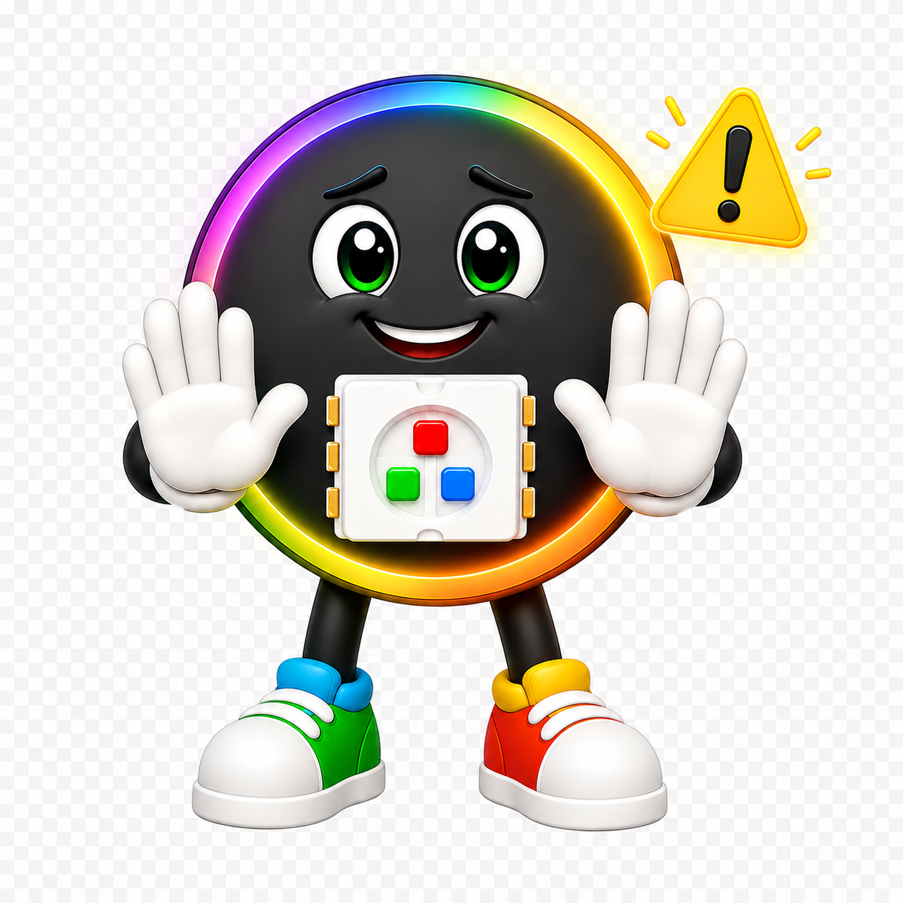
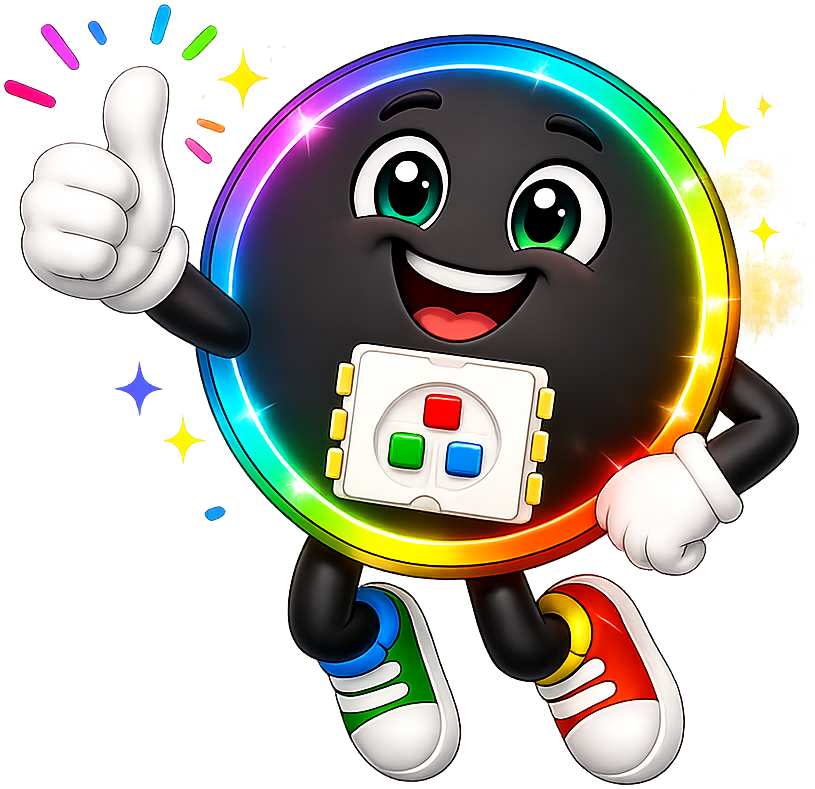

# Halloween Costume Kit

Light up your Halloween costume with a strip of 60 color LEDs! One button on the
costume changes the light show. Press it to switch from a glowing pumpkin to
flying bats, bubbling potions or a lightning storm.

!!! tip "Pixel says..."
    
    Hi, I'm Pixel! Halloween is my favorite night to glow. In these labs you'll
    write every spooky pattern yourself. Then you'll wear your code to the party.
    Let's light this up!

## What You'll Learn

These labs start with one blinking light and end with a full costume program.
Along the way you'll learn to:

- Run your first program on a real computer chip
- Read a **button press** in code
- Make lights **move**, **fade** and **sparkle**
- Use **lists** (ordered groups of values) to track many bats, bubbles or eyes
- Build a **state machine** (a program that can be in one of several modes)

## What's in the Kit

| Part | Notes |
|------|-------|
| Raspberry Pi Pico | The small computer that runs your code |
| 60-pixel WS2812B LED strip | 1 meter of NeoPixels (60 pixels per meter) |
| One momentary push button | A button that only counts while you hold it down |
| Jumper wires | Or solder the wires for a costume that holds up to dancing |
| USB battery pack | Powers the Pico and the strip while you walk around |
| USB cable | One that carries data, for programming |
| Tape, safety pins or a sewn sleeve | To hold the strip on your costume |

!!! warning "Watch out!"
    
    Some battery packs turn off when the power draw is very low. If your
    costume goes dark by itself, try a different battery pack. Pick one
    that stays on for small devices.

## How the Parts Connect

The strip needs only three wires, and the button needs two.

| From | To | What it does |
|------|----|--------------|
| Strip **DIN** (data in) | Pico **GP0** (pin 1) | Sends the colors to the strip |
| Strip **+5V** | Pico **VBUS** (pin 40) | Power for the strip, straight from USB |
| Strip **GND** | Pico **GND** (pin 38) | The shared return path |
| Button, one side | Pico **GP15** (pin 20) | The Pico reads the button here |
| Button, other side | Pico **GND** (pin 18) | Pressing connects GP15 to ground |

The button uses the Pico's internal **pull-up resistor** (a part inside the chip
that holds the pin at 1). That means you need no extra parts. The pin reads 1
when the button is up and 0 when you press it.

Look for the small arrows printed on the strip. They point away from **DIN**.
Connect the Pico to the end where the arrows start.

## The config.py File

Every program reads its settings from one shared file called `config.py`. You
never have to remember pin numbers.

```python
--8<-- "src/kits/halloween-60-button/config.py"
```

## Staying Safe on Battery Power

Each pixel has a red, a green and a blue LED inside. At full brightness, each
LED can use about 20 milliamps (mA). For 60 white pixels, that is:

\[
60 \times 3 \times 20 \text{ mA} = 3600 \text{ mA}
\]

That is too much for most USB battery packs. So every program multiplies its
colors by `BRIGHTNESS`. With `BRIGHTNESS = 0.25`, the most the strip can use
is about 900 mA. The colors still look bright in the dark!

## Getting Your Code onto the Costume

Use the `upload-code.sh` script to copy every lab onto the Pico. Close
Thonny first, because only one program can use the Pico at a time.

```bash
cd src/kits/halloween-60-button
./upload-code.sh
```

To make the costume start its light show by itself, save
`20-main-template.py` on the Pico with the name `main.py`. The Pico runs
`main.py` every time it gets power.

## The Labs

Work through these in order. Each one adds one new idea.

| Lab | Title | Program |
|-----|-------|---------|
| 1 | [Blink the Onboard LED](01-blink-onboard-led.md) | `01-blink-onboard-led.py` |
| 2 | [Hardware Probe](02-probe.md) | `02-probe.py` |
| 3 | [Blink the First Pixel](03-blink-first-pixel.md) | `03-blink-first-pixel.py` |
| 4 | [Move a Pixel](04-move-pixel.md) | `04-move-pixel.py` |
| 5 | [Button Test](05-button-test.md) | `05-button-test.py` |
| 6 | [Orange and Purple Chase](06-orange-and-purple-chase.md) | `06-orange-and-purple-chase.py` |
| 7 | [Pumpkin Glow](07-pumpkin-glow.md) | `07-pumpkin-glow.py` |
| 8 | [Candy Corn](08-candy-corn.md) | `08-candy-corn.py` |
| 9 | [Spooky Sparkle](09-spooky-sparkle.md) | `09-spooky-sparkle.py` |
| 10 | [Ghost Drift](10-ghost-drift.md) | `10-ghost-drift.py` |
| 11 | [Monster Eyes](11-monster-eyes.md) | `11-monster-eyes.py` |
| 12 | [Blood Drip](12-blood-drip.md) | `12-blood-drip.py` |
| 13 | [Bat Swarm](13-bat-swarm.md) | `13-bat-swarm.py` |
| 14 | [Cauldron Bubbles](14-cauldron-bubbles.md) | `14-cauldron-bubbles.py` |
| 15 | [Jack-o'-Lantern Fire](15-jack-o-lantern-fire.md) | `15-jack-o-lantern-fire.py` |
| 16 | [Lightning Storm](16-lightning-storm.md) | `16-lightning-storm.py` |
| 20 | [Main Template](20-main-template.md) | `20-main-template.py` |

Labs 1 to 5 test your parts. Labs 6 to 16 are Halloween patterns, from simple
to more complex. Lab 20 puts them all together with the button.

!!! success "You've got this!"
    
    You don't need to know any of this yet. That's what the labs are for.
    Take it one lab at a time, and your costume will be the brightest one at
    the party.

## What's Next

Start with [Lab 1: Blink the Onboard LED](01-blink-onboard-led.md). It runs
with no wiring at all.
