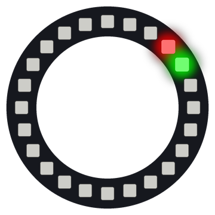

# Lab 2: First Pixel

A strip has two ends, so you can see where it starts. A ring has no ends at all. This program lights two pixels so you can find where the numbers start and which way they go.

!!! tip "Pixel says..."
    
    Time to meet your ring! One red blink tells you where pixel 0 lives. Let's go find it.

**Program file:** [`02-first-pixel.py`](https://github.com/dmccreary/moving-rainbow/blob/master/src/kits/ring-24/02-first-pixel.py)

{ width="260" }

*Drawn by a ring simulator on a computer, so your real ring may look a little different. On the real ring it moves.*

## What You'll Learn

- Read pin numbers from `config.py` (the file that describes your kit)
- Set one pixel with `strip[0] = ...` and show it with `strip.write()`
- Find pixel 0 and see which way the numbers run
- Use `BRIGHTNESS` (a number that dims every color) to keep the ring safe for USB power

## What You'll Need

- Your ring kit with the ring on GPIO 0
- `config.py` saved on the Pico

## The Program

This program blinks pixel 0 red and keeps pixel 1 green.

```python
--8<-- "src/kits/ring-24/02-first-pixel.py"
```

You should see one pixel blink red once a second, with a steady green pixel right next to it.

## How It Works

`strip[1] = fade(green, 1)` sets pixel 1 to green one time, before the loop. The loop only changes pixel 0, so the green pixel stays on.

Inside the loop, `pixel_on` flips between `True` and `False`. When it is `True`, pixel 0 turns red. When it is `False`, pixel 0 turns off with `(0, 0, 0)`. `strip.write()` sends the colors to the ring.

The green pixel comes after the red one. On this kit, green sits clockwise from red, so the numbers run clockwise. Pixel 0 sits at about 1:30 on a clock face.

`fade()` multiplies every color by `BRIGHTNESS`, which is `0.25` in `config.py`. That makes each pixel one quarter as bright. All 24 pixels at full white would pull more power than a USB port can give.

## Try It Yourself

1. Light pixel 2 in blue too. Where does it show up?
2. Change `DELAY` to `0.1`. How fast does the red pixel blink now?

## Check Your Understanding

1. Where is pixel 0 on your ring, using a clock face?
2. Do the pixel numbers go clockwise or counter-clockwise?
3. Why does the green pixel stay on while the red one blinks?

!!! success "Lab complete!"
    
    You found the start of a circle. That's a well-rounded result!

## What's Next

Go on to [Lab 3: Clock Positions](03-clock-positions.md).
