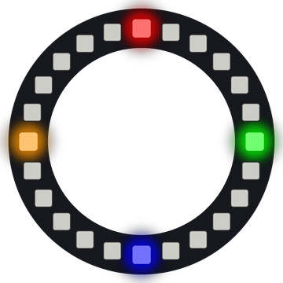

# Lab 3: Clock Positions

This program marks four spots on the ring like a clock face. It also sets up the ring for the way you mounted it, so "up" means up in every lab after this one.

!!! tip "Pixel says..."
    
    Pixel 0 is not at the top of the ring. No problem! Today we teach the ring where the top is. It's about time.

**Program file:** [`03-clock-positions.py`](https://github.com/dmccreary/moving-rainbow/blob/master/src/kits/ring-24/03-clock-positions.py)

{ width="260" }

*Drawn by a ring simulator on a computer, so your real ring may look a little different.*

## What You'll Learn

- Use a **function** (a named chunk of code you can run again and again) called `pixel_at()`
- Use `%`, the **remainder operator** (the amount left over after you divide), to wrap past pixel 23
- Set `TOP_PIXEL` in `config.py` to match how your ring is mounted
- Split 24 pixels into quarters with `//` (division that drops the remainder)

## What You'll Need

- Your ring kit with the ring on GPIO 0
- `config.py` saved on the Pico
- Thonny open so you can see the Shell

## The Program

This program lights red at 12 o'clock, green at 3, blue at 6 and yellow at 9.

```python
--8<-- "src/kits/ring-24/03-clock-positions.py"
```

You should see red at the top, green on the right, blue at the bottom and yellow on the left. The Shell prints the pixel number for each spot.

## How It Works

A **position** is a count of steps clockwise from the top. Position 0 is 12 o'clock, position 6 is 3 o'clock, position 12 is 6 o'clock and position 18 is 9 o'clock.

`pixel_at(position)` turns a position into a real pixel number. It adds the position to `TOP_PIXEL`, which is `21` on this kit. So 3 o'clock would be 21 + 6 = 27. There is no pixel 27! The `% NUMBER_PIXELS` part keeps the remainder after dividing by 24. 27 divided by 24 leaves 3, so 3 o'clock is pixel 3.

`QUARTER = NUMBER_PIXELS // 4` works out to 6. Then `QUARTER * 2` is 12 and `QUARTER * 3` is 18. The Shell shows 21, 3, 9 and 15.

This program has no loop. It lights the four pixels once and stops, but the pixels stay lit.

**Is red not at the top?** Open `config.py` and change `TOP_PIXEL`. If red is one spot too far clockwise, make the number one smaller. If it is one spot short, make it one bigger. Save `config.py` on the Pico and run this lab again. Repeat until red is at the top.

## Try It Yourself

1. Light all twelve hour marks. Hint: use a `for` loop and `pixel_at(hour * 2)`.
2. Turn your ring a quarter turn on the table. Find the new `TOP_PIXEL` so red is at the top again.

## Check Your Understanding

1. What is `27 % 24`?
2. On this kit, which pixel number is at 12 o'clock?
3. Why do the later labs use `pixel_at()` in place of plain pixel numbers?

!!! success "Lab complete!"
    
    Your ring knows which way is up. Way to point it in the right direction!

## What's Next

Go on to [Lab 4: Button Test](04-button-test.md).
