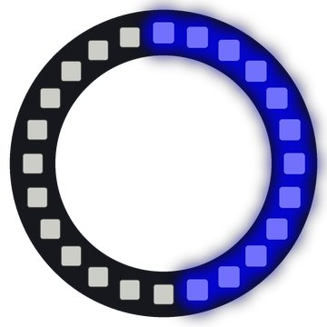

# Lab 4: Button Test

Your ring kit has two buttons. This program shows what the Pico sees when you press each one, and it lights half of the ring for each button.

!!! tip "Pixel says..."
    
    Now your ring can listen to you! Press a button and watch half the circle light up.

**Program file:** [`04-button-test.py`](https://github.com/dmccreary/moving-rainbow/blob/master/src/kits/ring-24/04-button-test.py)

{ width="260" }

*Drawn by a ring simulator on a computer, so your real ring may look a little different. On the real ring it moves.*

## What You'll Learn

- Read a button with `button1.value()`
- Learn why a pressed button reads 0
- Use an `if` statement to make a choice
- Print only when something **changes** (is different from last time)

## What You'll Need

- Your ring kit with Button 1 wired from GPIO 15 to GND and Button 2 wired from GPIO 14 to GND
- `config.py` saved on the Pico
- Thonny open so you can see the Shell

## The Program

This program checks both buttons twenty times a second and lights one half of the ring for each.

```python
--8<-- "src/kits/ring-24/04-button-test.py"
```

Hold Button 1 and the right half of the ring glows blue. Hold Button 2 and the left half glows yellow. The Shell prints a new line each time a button goes down or up.

## How It Works

Each button connects its pin to GND (ground). `Pin.PULL_UP` holds the pin at 1 when the button is up. Pressing the button connects it to ground, so it reads 0.

`fade(blue, 1 - value1)` turns that around. When Button 1 is up, `1 - 1` is 0, so the pixel is off. When it is pressed, `1 - 0` is 1, so the pixel lights up.

The `for` loop counts positions 0 to 23 clockwise from the top. `if position < NUMBER_PIXELS // 2:` picks positions 0 to 11, the right half of the ring. The `else:` part handles positions 12 to 23, the left half.

`last_value1` and `last_value2` remember what the buttons read last time. The program prints only when a new reading is different, so the Shell stays tidy.

## Try It Yourself

1. Change the colors so Button 1 lights green and Button 2 lights red.
2. Make each button light a quarter of the ring in place of a half. Hint: compare `position` to `NUMBER_PIXELS // 4`.

## Check Your Understanding

1. What value does a button have when you press it?
2. Which pin is Button 2 on?
3. Why does the program use `1 - value1` in place of `value1`?

!!! success "Lab complete!"
    
    Both buttons work. You pressed on and lit up!

## What's Next

Go on to [Lab 5: Spin a Dot](05-spin-dot.md).
