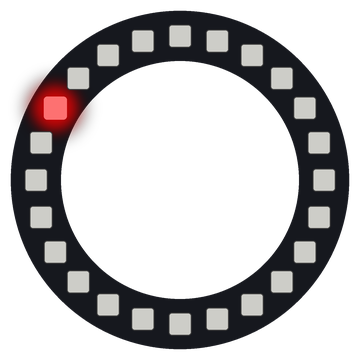

# Lab 5: Spin a Dot

One red dot goes around and around the ring. On a strip, a moving dot has to stop at the end. On a ring, it can keep going forever.

!!! tip "Pixel says..."
    
    A circle has no finish line, so our dot never has to stop. Let's take it for a spin!

**Program file:** [`05-spin-dot.py`](https://github.com/dmccreary/moving-rainbow/blob/master/src/kits/ring-24/05-spin-dot.py)

{ width="260" }

*Drawn by a ring simulator on a computer, so your real ring may look a little different. On the real ring it moves.*

## What You'll Learn

- Move a dot by changing a **position** (the pixel number where the dot is)
- Use `%`, the **remainder operator** (the amount left over after you divide), to wrap from pixel 23 to pixel 0
- Erase a pixel in memory before the next write

## What You'll Need

- Your ring kit with the ring on GPIO 0
- `config.py` saved on the Pico

## The Program

This program moves one red dot clockwise around the ring.

```python
--8<-- "src/kits/ring-24/05-spin-dot.py"
```

You should see a red dot race around the ring clockwise, one lap about every second and a half.

## How It Works

Each time through the loop, the program lights the pixel at `position`, writes it and waits `DELAY` seconds. Then it sets that pixel back to `(0, 0, 0)`. That change stays in memory until the next `strip.write()`, so you never see a dark ring.

`position = (position + 1) % NUMBER_PIXELS` moves the dot one step. When `position` is 23, adding 1 gives 24. There is no pixel 24! But 24 divided by 24 leaves a remainder of 0, so the dot goes on to pixel 0.

This program uses plain pixel numbers, not `pixel_at()`. The dot starts at pixel 0, which is at about 1:30 on a clock face.

## Try It Yourself

1. Change `DELAY` to `0.02`. Then try `0.2`. Which speed do you like best?
2. Make the dot go counter-clockwise. Hint: change `+ 1` to `- 1`.

## Check Your Understanding

1. What is `24 % 24`?
2. What would happen if you took out `% NUMBER_PIXELS`?
3. Why can the program erase the dot right after it waits?

!!! success "Lab complete!"
    
    Round and round it goes! You made something that never runs out of road.

## What's Next

Go on to [Lab 6: Comet](06-comet.md).
