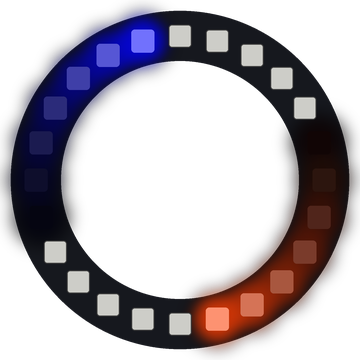

# Lab 7: Two Comets

A blue comet and an orange comet chase each other around the ring. They always stay on opposite sides, like two riders on a merry-go-round.

!!! tip "Pixel says..."
    
    One comet was fun. Two comets make a chase! Can the blue one ever catch the orange one?

**Program file:** [`07-two-comets.py`](https://github.com/dmccreary/moving-rainbow/blob/master/src/kits/ring-24/07-two-comets.py)

{ width="260" }

*Drawn by a ring simulator on a computer, so your real ring may look a little different. On the real ring it moves.*

## What You'll Learn

- Find the spot **opposite** (directly across the ring) by adding half the ring
- Draw two shapes in the same loop
- Use `//` (division that drops the remainder) to find half of 24

## What You'll Need

- Your ring kit with the ring on GPIO 0
- `config.py` saved on the Pico

## The Program

This program draws two 8-pixel comets, half a ring apart, that both go clockwise.

```python
--8<-- "src/kits/ring-24/07-two-comets.py"
```

You should see a blue comet and an orange comet spin clockwise, always straight across from each other.

## How It Works

`HALF = NUMBER_PIXELS // 2` works out to 12. Adding 12 to any position gives the spot directly across the ring.

Inside the `for` loop, each value of `t` draws two pixels. The blue pixel is at `position - t`. The orange pixel is at `position + HALF - t`. Both use `% NUMBER_PIXELS` to wrap across pixel 0.

Both comets move one step each time `position` goes up by 1. They move at the same speed, so the gap between them stays at 12 pixels forever.

## Try It Yourself

1. Add a third comet. Hint: 24 divides evenly by 3, so space them `NUMBER_PIXELS // 3` apart.
2. Change the orange comet to green.

## Check Your Understanding

1. What is `NUMBER_PIXELS // 2` on this ring?
2. If the blue head is at pixel 20, where is the orange head?
3. Why does the blue comet never catch the orange one?

!!! success "Lab complete!"
    
    Two comets, one ring, zero crashes. Stellar work!

## What's Next

Go on to [Lab 8: Meet and Flash](08-meet-and-flash.md).
