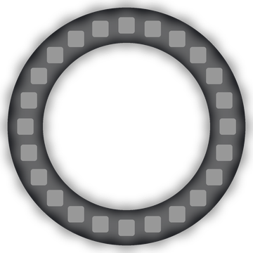

# Lab 8: Meet and Flash

Two dots leave the top of the ring and go around opposite sides. When they meet, the whole ring flashes white.

!!! tip "Pixel says..."
    
    One dot goes left and one goes right. Where will they bump into each other? Let's light up the meeting spot!

**Program file:** [`08-meet-and-flash.py`](https://github.com/dmccreary/moving-rainbow/blob/master/src/kits/ring-24/08-meet-and-flash.py)

{ width="260" }

*Drawn by a ring simulator on a computer, so your real ring may look a little different. On the real ring it moves.*

## What You'll Learn

- Move one dot **clockwise** (the way clock hands turn) and one **counter-clockwise** (the other way)
- Use a **negative number** (a number below zero) as a position
- Use `%` to check when the dots are in the same place

## What You'll Need

- Your ring kit with the ring on GPIO 0
- `config.py` saved on the Pico, with `TOP_PIXEL` set in Lab 3

## The Program

This program moves a cyan dot clockwise and a violet dot counter-clockwise, and flashes the ring when they meet.

```python
--8<-- "src/kits/ring-24/08-meet-and-flash.py"
```

You should see the two dots split at the top and race down each side. The ring flashes white when they meet at the bottom, and again when they get back to the top.

## How It Works

`distance` counts how far each dot has gone from the top. The cyan dot is at `pixel_at(distance)`, so it moves clockwise. The violet dot is at `pixel_at(-distance)`, so it moves counter-clockwise.

How can a position be negative? `pixel_at()` uses `%`. In Python, `%` always gives a number from 0 to 23 here, even for a negative number. So `-1 % 24` is 23, one step counter-clockwise from 0.

`distance % HALF == 0` is true when `distance` is 0 or 12. At 0, both dots are at the top. At 12, both dots are at the bottom. Those are the times to flash. `strip.fill(fade(white, 0.5))` fills the whole ring with dim white for one step.

## Try It Yourself

1. Change `DELAY` to `0.15` so each flash stays on longer.
2. Make the flash a different color, like yellow `(255, 150, 0)`.

## Check Your Understanding

1. Which dot goes clockwise: cyan or violet?
2. At which two values of `distance` does the ring flash?
3. What is `-3 % 24`?

!!! success "Lab complete!"
    
    Flash! Your dots met in the middle. What a bright idea!

## What's Next

Go on to [Lab 9: Color Wheel](09-color-wheel.md).
