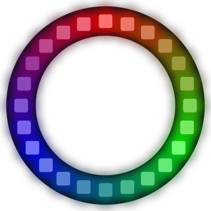

# Lab 9: Color Wheel

This program paints a real color wheel on the ring. Each pixel's color depends on where it sits around the circle, like the color wheel in an art room.

!!! tip "Pixel says..."
    
    A rainbow on a strip has two ends. A rainbow on a ring joins up with itself! Let's paint the whole circle.

**Program file:** [`09-color-wheel.py`](https://github.com/dmccreary/moving-rainbow/blob/master/src/kits/ring-24/09-color-wheel.py)

{ width="260" }

*Drawn by a ring simulator on a computer, so your real ring may look a little different.*

## What You'll Learn

- Use a **color wheel** (colors placed around a circle, from red to green to blue and back to red)
- Find the **angle** (how far around the circle, in degrees) of each pixel
- Turn a number from 0 to 255 into a color with the `wheel()` function

## What You'll Need

- Your ring kit with the ring on GPIO 0
- `config.py` saved on the Pico, with `TOP_PIXEL` set in Lab 3
- Thonny open so you can see the Shell

## The Program

This program gives each of the 24 pixels its own color and then stops.

```python
--8<-- "src/kits/ring-24/09-color-wheel.py"
```

You should see red at the top, green at about 4 o'clock and blue at about 8 o'clock, with smooth blends in between. The Shell prints the angle and color of each pixel.

## How It Works

A full circle is 360 degrees. `360 // 24` is 15, so each pixel sits 15 degrees past its neighbor. The program prints that `angle` for each position so you can see it grow from 0 to 345.

`wheel()` takes a number from 0 to 255. It starts at red, fades to green at 85, then to blue at 170, then back toward red. `position * 256 // NUMBER_PIXELS` spreads the 24 positions evenly across those 256 steps. Each pixel gets a color about one twenty-fourth of the way past the last one.

The last pixel, at position 23, is a red with a touch of blue. The next step after it would be pure red again, which is the top pixel. So the colors meet with no **seam** (a sharp jump where two ends join).

The program has no `while True:` loop. It paints the wheel once with one `strip.write()`, and the colors stay lit.

## Try It Yourself

1. Change `fade(color, 1)` to `fade(color, 0.3)`. How does the wheel look now?
2. Add 128 to the wheel number. Hint: use `wheel((position * 256 // NUMBER_PIXELS + 128) % 256)`. Which color is at the top now?

## Check Your Understanding

1. How many degrees apart are two neighbor pixels on this ring?
2. What color does `wheel(0)` give?
3. Why is there no seam where the last pixel meets the first?

!!! success "Lab complete!"
    
    You painted a whole wheel of color. That's a full-circle win!

## What's Next

Go on to [Lab 10: Spinning Rainbow](10-spinning-rainbow.md).
