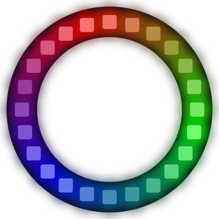

# Lab 10: Spinning Rainbow

The color wheel from Lab 9 comes to life and spins around the ring. At every step, each color moves along by one pixel.

!!! tip "Pixel says..."
    
    A rainbow that goes round and round? Now that's a bright idea. Let's give the color wheel a spin!

**Program file:** [`10-spinning-rainbow.py`](https://github.com/dmccreary/moving-rainbow/blob/master/src/kits/ring-24/10-spinning-rainbow.py)

{ width="260" }

*Drawn by a ring simulator on a computer, so your real ring may look a little different. On the real ring it moves.*

## What You'll Learn

- Use an **offset** (a number added to every position to shift a whole pattern) to move a pattern
- Use the **remainder operator** `%` (it gives what is left over after dividing) to wrap pixel 23 back to pixel 0
- Turn a number from 0 to 255 into a color with `wheel()`
- Change which way a pattern spins

## What You'll Need

- Your ring kit with the ring on GPIO 0
- `config.py` saved on the Pico

## The Program

This program paints a rainbow around the ring and moves it one pixel at each step.

```python
--8<-- "src/kits/ring-24/10-spinning-rainbow.py"
```

You should see a full rainbow spin clockwise around the ring, about once every second.

## How It Works

`wheel(pos)` turns a number from 0 to 255 into a color. It starts at red, moves through green and blue, and comes back toward red at 255.

`i * 256 // NUMBER_PIXELS` spreads the 24 pixels evenly across the wheel. The `//` sign divides and drops any decimal part. So the colors use wheel numbers 0, 10, 21, 32 and so on, up to 245.

`(i + offset) % NUMBER_PIXELS` is the pixel where color `i` goes. When `i + offset` reaches 24 or more, `%` wraps it back to the start. For example, `25 % 24` is `1`. A ring has no ends, so the rainbow never runs out of room.

After each `strip.write()`, `offset` goes up by one. Every color moves to the next higher pixel number. The numbers on this ring run clockwise, so the rainbow spins clockwise. The `% NUMBER_PIXELS` on the last line keeps `offset` counting 0 to 23 and then starting over.

## Try It Yourself

1. Make the rainbow spin the other way. Change `offset + 1` to `offset - 1` on the last line. Python's `%` turns `-1` into `23`, so the wrap still works.
2. Change `DELAY` to `0.01` for a fast spin, or to `0.2` for a slow one.

## Check Your Understanding

1. What is `26 % 24`?
2. Which line makes the rainbow move?
3. Why does a ring work so well for a rainbow that spins?

!!! success "Lab complete!"
    
    Round and round it goes! You made a rainbow with no beginning and no end.

## What's Next

Go on to [Lab 11: Pinwheel](11-pinwheel.md).
