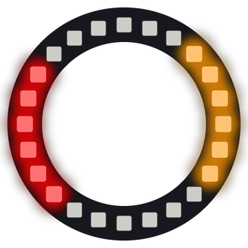

# Lab 11: Pinwheel

Colored blades spin around the ring like a pinwheel in the wind. Every few seconds, the pinwheel changes how many blades it has.

!!! tip "Pixel says..."
    
    A pinwheel needs blades that fit perfectly around the circle. Let's find out which numbers fit around 24 pixels!

**Program file:** [`11-pinwheel.py`](https://github.com/dmccreary/moving-rainbow/blob/master/src/kits/ring-24/11-pinwheel.py)

{ width="260" }

*Drawn by a ring simulator on a computer, so your real ring may look a little different. On the real ring it moves.*

## What You'll Learn

- Use **integer division** `//` (dividing and dropping any decimal part) to group pixels into sections
- Find the **divisors** of 24 (numbers that divide into 24 with nothing left over)
- Use `% 2` to tell **even** numbers (0, 2, 4...) from **odd** numbers (1, 3, 5...)
- Pick an item from a **tuple** (a list of values that never changes) by its place in line

## What You'll Need

- Your ring kit with the ring on GPIO 0
- `config.py` saved on the Pico

## The Program

This program splits the ring into blades and gaps, then spins them.

```python
--8<-- "src/kits/ring-24/11-pinwheel.py"
```

You should see colored blades spin counter-clockwise. About every 5 seconds the pinwheel changes from 2 blades to 3, 4, 6 and 12, and then starts over at 2.

## How It Works

`blade_counts` holds the numbers 2, 3, 4, 6 and 12. `step // STEPS_PER_COUNT` goes up by one every 60 steps. The `% len(blade_counts)` part wraps it back to the first count after the last one.

Each blade has a gap after it. So a pinwheel with `blades` blades has `blades * 2` sections. `width = NUMBER_PIXELS // (blades * 2)` is how many pixels wide each section is. For 3 blades there are 6 sections, and each one is `24 // 6` = 4 pixels wide.

This only works when the sections fit with nothing left over. 24 divides evenly by 2, 3, 4, 6, 8 and 12. The section counts here are 4, 6, 8, 12 and 24, which are 2 × 2, 2 × 3, 2 × 4, 2 × 6 and 2 × 12. All of them fit, so the blades join up with no seam.

`section = ((i + step) // width) % (blades * 2)` finds which section pixel `i` is in. If `section % 2 == 0`, the section number is even and the pixel is part of a blade. If it is odd, the pixel is a gap and stays dark. `blade_colors[(section // 2) % len(blade_colors)]` gives the blades red, yellow, green and blue in turn.

Adding `step` shifts the pattern by one pixel each time. The pattern slides toward lower pixel numbers, so the pinwheel spins counter-clockwise.

## Try It Yourself

1. Add `8` to the list: `blade_counts = (2, 3, 4, 6, 8, 12)`. Watch for the spot where the pattern breaks. Hint: 8 blades need 16 sections. Does 24 divide evenly by 16?
2. Make the pinwheel spin clockwise. Change `(i + step)` to `(i - step)`.

## Check Your Understanding

1. What is `24 // 6`?
2. Why does a pinwheel with 5 blades not fit on this ring?
3. How does the program decide if a pixel is a blade or a gap?

!!! success "Lab complete!"
    
    Wheel done! Your pinwheel spins all day with no wind at all.

## What's Next

Go on to [Lab 12: Loading Spinner](12-loading-spinner.md).
