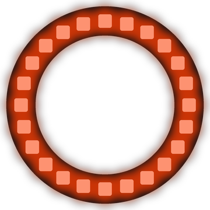

# Lab 13: Breathing Halo

The whole ring glows brighter and dimmer, like slow and calm breathing. At its darkest moment, the halo quietly switches to a new color.

!!! tip "Pixel says..."
    
    Breathe in... breathe out... Even LEDs like to relax. Let's make a halo that glows with every breath.

**Program file:** [`13-breathing-halo.py`](https://github.com/dmccreary/moving-rainbow/blob/master/src/kits/ring-24/13-breathing-halo.py)

{ width="260" }

*Drawn by a ring simulator on a computer, so your real ring may look a little different. On the real ring it moves.*

## What You'll Learn

- Use `abs()`, the **absolute value** (how far a number is from zero, so -30 becomes 30), to count down and back up
- Square a number to make a fade look smoother
- Hide a color change by making it at the darkest moment
- Work out how much **current** (the flow of electricity) the ring uses

## What You'll Need

- Your ring kit with the ring on GPIO 0
- `config.py` saved on the Pico

## The Program

This program fills the whole ring with one color and fades it up and down.

```python
--8<-- "src/kits/ring-24/13-breathing-halo.py"
```

You should see the ring fade from bright to almost dark and back, about once every 4 seconds. Each time it is darkest, the color changes: red, orange, green, cyan, blue, violet, and then red again.

## How It Works

`step` counts from 0 to 199 and then starts over. `abs(step - HALF_BREATH)` is 100 at step 0, falls to 0 at step 100, and climbs back toward 100 at step 199. Dividing by `HALF_BREATH` turns this into a `level` that goes from 1.0 down to 0.0 and back up.

Our eyes notice small changes in dim light more than in bright light. Squaring the level (`level * level`) keeps the ring dim for longer, so the fade looks smooth. For example, 0.5 × 0.5 is only 0.25. The `0.02 +` part means the halo never goes fully dark.

When `step` equals `HALF_BREATH`, the ring is at its darkest. That is when `color_index` moves on to the next color. The change happens in the dark, so you never see the color jump.

This is the brightest program in the kit, because `strip.fill()` lights all 24 pixels at once. Cyan is the hungriest color, since it turns on both the green and blue parts of every pixel. At the top of a cyan breath, the ring uses about 240 **milliamps** (mA, a unit for measuring current). A USB port can supply about 500 mA. Setting `BRIGHTNESS = 0.25` in `config.py` keeps the ring safely under that.

## Try It Yourself

1. Change `HALF_BREATH` to `50`. Does the halo breathe faster or slower?
2. Make a new color, such as `pink = (255, 20, 100)`, and add `pink` to the `colors` tuple.

## Check Your Understanding

1. What does `abs(-30)` give you?
2. Why does the color change at the darkest point?
3. Which color in this program uses the most current, and why?

!!! success "Lab complete!"
    
    Breathtaking work! Your halo glows calm and bright.

## What's Next

Go on to [Lab 14: Sine Wave](14-sine-wave.md).
