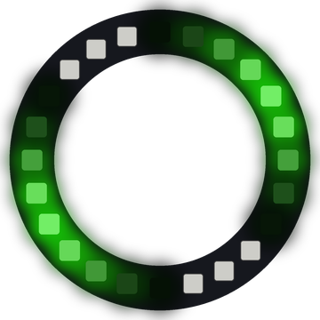

# Lab 14: Sine Wave

Smooth waves of light roll around the ring. Each wave joins up with itself, so the waves can roll forever with no seam.

!!! tip "Pixel says..."
    
    Surf's up! Today we ride a wave made of math. Let's light this up!

**Program file:** [`14-sine-wave.py`](https://github.com/dmccreary/moving-rainbow/blob/master/src/kits/ring-24/14-sine-wave.py)

{ width="260" }

*Drawn by a ring simulator on a computer, so your real ring may look a little different. On the real ring it moves.*

## What You'll Learn

- Use **sine**, written `sin()` (math that turns an angle into a smooth up-and-down number), to make waves
- Measure angles in **radians** (another way to measure angles, where a full circle is about 6.28)
- Turn a number from -1 to 1 into a brightness from 0 to 1
- Move a wave with a **phase** (how far the wave has been shifted around the circle)

## What You'll Need

- Your ring kit with the ring on GPIO 0
- `config.py` saved on the Pico

## The Program

This program sets each pixel's brightness from a sine wave, then shifts the wave a little at each step.

```python
--8<-- "src/kits/ring-24/14-sine-wave.py"
```

You should see two bright waves roll clockwise around the ring. Their color slowly drifts through the whole rainbow.

## How It Works

Picture a dot riding around a circle. **Sine** tells you how high that dot is. It starts at 0, rises to 1, falls through 0 down to -1, and comes back to 0. Then it repeats. A ring is a circle too, so a sine wave fits around it perfectly.

A full circle is 360 degrees, so each of our 24 pixels is 360 / 24 = 15 degrees from its neighbor. Python's `sin()` uses radians instead of degrees. In radians, a full circle is 2 × π, or about 6.28. The program calls that `FULL_CIRCLE`.

`angle = FULL_CIRCLE * CRESTS * i / NUMBER_PIXELS` gives each pixel an angle. A **crest** is the bright top of a wave. With `CRESTS = 2`, the angle goes around the circle twice while you go once around the ring, so you see two waves.

`sin()` gives a number from -1 to 1. Adding 1 gives 0 to 2, and dividing by 2 gives 0 to 1. That is a perfect amount for `fade()`.

Pixels between a crest and a dark spot get in-between brightness, so the wave looks smooth instead of blocky. Squaring it with `wave * wave` makes the dark parts darker, so each wave looks sharper.

Subtracting `phase` shifts the whole wave. Each step, `phase` grows by `SPEED`, so the waves roll around. `% FULL_CIRCLE` keeps `phase` from growing forever. `hue` also grows by 1 each step, so the color slowly changes.

## Try It Yourself

1. Change `CRESTS` to `1`, `3` or `4`. How many waves do you count each time?
2. Change `CRESTS` to `1.5`. Look closely where pixel 23 meets pixel 0, at about 1:30 on a clock face. What do you see?

## Check Your Understanding

1. What is the biggest number `sin()` can give? What is the smallest?
2. Why does the program add 1 and then divide by 2?
3. Why does `CRESTS` need to be a whole number on a ring?

!!! success "Lab complete!"
    
    Wave-tastic! You turned math into rolling light.

## What's Next

Go on to [Lab 15: Ripples](15-ripple.md).
