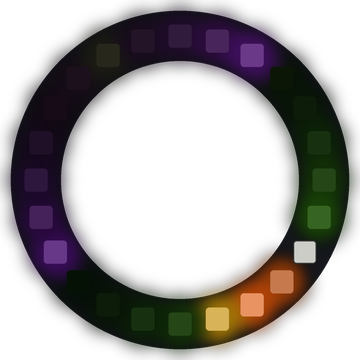

# Lab 15: Ripples

Drops of light land at random spots on the ring. A ripple spreads out both ways from each drop, and its two sides crash together on the far side.

!!! tip "Pixel says..."
    
    Plop! Drops of color are falling on our pond. Watch where each ripple meets itself.

**Program file:** [`15-ripple.py`](https://github.com/dmccreary/moving-rainbow/blob/master/src/kits/ring-24/15-ripple.py)

{ width="260" }

*Drawn by a ring simulator on a computer, so your real ring may look a little different. On the real ring it moves.*

## What You'll Learn

- Use `randint()` to pick **random** numbers (numbers chosen by chance)
- Store each ripple as a small list with a center, a **radius** (how far it has spread) and a color
- Leave a fading **trail** by dimming every pixel a little each step
- **Mix** two colors by adding their red, green and blue parts
- Remove items from a list while looping over a copy of it

## What You'll Need

- Your ring kit with the ring on GPIO 0
- `config.py` saved on the Pico

## The Program

This program drops ripples at random places and spreads each one around the ring.

```python
--8<-- "src/kits/ring-24/15-ripple.py"
```

You should see colored ripples pop up in random spots. Each one spreads both ways with a short fading tail, and its two sides meet on the opposite side of the ring.

## How It Works

Each ripple is a list like `[center, radius, color]`. The radius starts at 0 and grows by 1 each step. The ripple lights two pixels: `center + radius` on one side and `center - radius` on the other. `% NUMBER_PIXELS` wraps both onto the ring, so even -3 becomes pixel 21.

`HALF` is 12, half of the ring. When the radius reaches 12, both sides land on the same pixel, right across from the center. That is where they crash. Then `ripples.remove(ripple)` takes the ripple away.

Looping over `ripples[:]`, a copy of the list, lets the program remove a ripple safely in the middle of the loop.

At the start of each step, `strip[i]` reads each pixel's color back. Then every pixel keeps only `DIM` (60%) of its light. Pixels that a ripple has passed fade out, which makes the short trail.

`mix()` adds two colors together, so overlapping ripples blend. Red and blue make purple. `min(..., 255)` keeps each part at 255 or less.

`randint(1, 100) <= DROP_CHANCE` is true about 12 times out of 100. That is how often a new drop lands, as long as there are fewer than `MOST_RIPPLES` (3) ripples.

## Try It Yourself

1. Change `DIM` to `0.85`. What happens to the trails?
2. Change `DROP_CHANCE` to `40` and `MOST_RIPPLES` to `6`. Does it look like it is raining harder?

## Check Your Understanding

1. A ripple is centered on pixel 5. Which two pixels does it light when its radius is 3?
2. Why does a ripple stop when its radius reaches 12?
3. What does `mix()` do when two ripples overlap?

!!! success "Lab complete!"
    
    You made a splash! Your pond of light ripples all on its own.

## What's Next

Go on to [Lab 16: Radar](16-radar.md).
