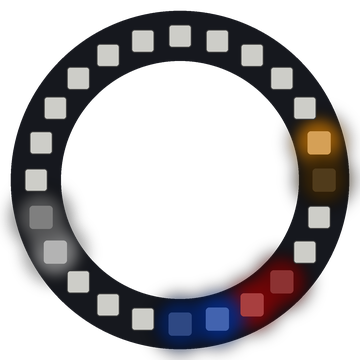

# Lab 17: Planets

Four planets orbit around the ring, each at its own speed. They keep passing each other, and they glide smoothly from pixel to pixel.

!!! tip "Pixel says..."
    
    Welcome to our tiny solar system! The planets go round and round, and so does the fun.

**Program file:** [`17-planets.py`](https://github.com/dmccreary/moving-rainbow/blob/master/src/kits/ring-24/17-planets.py)

{ width="260" }

*Drawn by a ring simulator on a computer, so your real ring may look a little different. On the real ring it moves.*

## What You'll Learn

- Make an **orbit** (a path that goes around and around) faster or slower by changing a speed
- Store a position as a **decimal number** (a number with a part after the dot, like 7.25)
- Share light between two pixels to show a spot between them
- **Mix** colors where two planets overlap

## What You'll Need

- Your ring kit with the ring on GPIO 0
- `config.py` saved on the Pico

## The Program

This program moves four planets around the ring and draws each one softly across two pixels.

```python
--8<-- "src/kits/ring-24/17-planets.py"
```

You should see orange, white, blue and red planets circle clockwise. The orange one is fastest and the red one is slowest, so the fast planets keep lapping the slow ones.

## How It Works

Each planet is a list: `[position, speed, color]`. The speed is how many pixels the planet moves each step. Orange moves 0.32 pixels each step, so it goes around once in 75 steps. Red moves only 0.08 pixels, so it needs 300 steps.

A planet's position is a decimal number, like 7.25. But pixels only come in whole numbers. `draw_soft()` solves this. `int(position)` drops the decimal part, so `lower` is pixel 7, `upper` is the next pixel, 8, and `part` is the piece that was dropped, 0.25.

Then pixel 7 gets 75% of the light (`1 - part`) and pixel 8 gets 25% (`part`). Your eye blends the two pixels and sees a planet a quarter of the way from 7 to 8. As the position grows, the light slides smoothly from one pixel to the next.

`upper = (lower + 1) % NUMBER_PIXELS` wraps pixel 24 back to pixel 0. So a planet at 23.5 shares its light between pixels 23 and 0. Each planet's new position is wrapped with `%` too, so the planets orbit forever.

`draw_soft()` uses `mix()` to add each planet's light to what is already on the pixel. When two planets pass each other, their colors add up for a moment.

## Try It Yourself

1. Add a fifth planet. Copy a line in `planets`, then change its position, speed and color. Try `[3.0, 0.05, (0, 255, 0)],` for a slow green planet.
2. Give one planet a negative speed, like `-0.15`. Which way does it orbit now?

## Check Your Understanding

1. A planet is at position 12.5. Which two pixels light up, and how bright is each one?
2. Which planet finishes a lap first, and why?
3. What does `mix()` do when two planets pass each other?

!!! success "Lab complete!"
    
    Out of this world! Your planets glide around like the real thing.

## What's Next

Go on to [Lab 18: Pendulum](18-pendulum.md).
