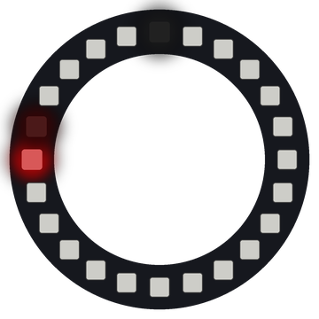

# Lab 18: Pendulum

A ball of light swings back and forth along the bottom of the ring, like a pendulum. Each swing is a little smaller, until the ball gets a new push and a new color.

!!! tip "Pixel says..."
    
    Tick, tock, swing! Let's use a sine wave to make a ball swing like the real thing.

**Program file:** [`18-pendulum.py`](https://github.com/dmccreary/moving-rainbow/blob/master/src/kits/ring-24/18-pendulum.py)

{ width="260" }

*Drawn by a ring simulator on a computer, so your real ring may look a little different. On the real ring it moves.*

## What You'll Learn

- Make a **pendulum** (a weight that swings back and forth on a string) with `sin()`
- Find the bottom of the ring from `TOP_PIXEL`
- Use **decay** (shrinking a number by a tiny bit each step) to slow the swing down
- Use `draw_soft()` so the ball glides between pixels

## What You'll Need

- Your ring kit with the ring on GPIO 0
- `config.py` saved on the Pico, with `TOP_PIXEL` set in Lab 3

## The Program

This program swings a ball from side to side around the bottom of the ring.

```python
--8<-- "src/kits/ring-24/18-pendulum.py"
```

You should see a dim white pixel at the top, where the pendulum hangs. A red ball swings below it, and each swing gets smaller. After about half a minute, the ball gets a new push and a new color.

## How It Works

`BOTTOM` is the pixel at 6 o'clock. That spot is half the ring away from the top, so the program adds 12 to `TOP_PIXEL`. `21 + 12` is 33, which is bigger than 23. The program wraps it later with `% NUMBER_PIXELS`, and `33 % 24` is 9. So the bottom is pixel 9.

`sin(time_counter)` goes smoothly from 0 up to 1, back through 0 down to -1, and back to 0. Multiplying by `swing` turns that into how many pixels the ball is from the bottom. With a swing of 10, the ball goes 10 pixels one way and 10 pixels the other way. Each pixel is 15 degrees, so that is 150 degrees each side.

A real pendulum moves fastest at the bottom and slows down at each end, where it turns around. A sine wave does the same thing. It changes fast near 0, and it changes slowly near 1 and -1.

Each step, `swing = swing * SWING_DECAY` keeps 99.7% of the swing. That tiny loss adds up, like air slowly stopping a real pendulum. When `swing` drops below 0.5, the ball gets a new push. `swing` goes back to `BIGGEST_SWING`, and `color_index` moves to the next color.

`draw_soft()` shares the ball's light between two pixels, so it glides smoothly. `strip[TOP_PIXEL]` glows dim white at 0.1 to show where the pendulum hangs.

## Try It Yourself

1. Change `SWING_DECAY` to `0.99`. How long does each set of swings last now?
2. Change `SWING_SPEED` to `0.15`. Does the pendulum swing faster or slower?

## Check Your Understanding

1. Which pixel is at 6 o'clock on this ring?
2. Where does the ball move fastest, and why?
3. Why must `BIGGEST_SWING` stay less than 12?

!!! success "Lab complete!"
    
    You swung it! Your pendulum swings like a real one.

## What's Next

Go on to [Lab 19: Water Level](19-water-level.md).
