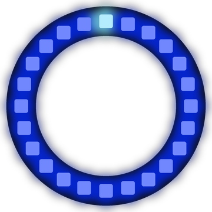

# Lab 19: Water Level

Blue water fills the ring from the bottom. It climbs up both sides at once, reaches the top and then drains away again.

!!! tip "Pixel says..."
    
    Time to make a splash! We will fill the ring like a glass of water.

**Program file:** [`19-water-level.py`](https://github.com/dmccreary/moving-rainbow/blob/master/src/kits/ring-24/19-water-level.py)

{ width="260" }

*Drawn by a ring simulator on a computer, so your real ring may look a little different. On the real ring it moves.*

## What You'll Learn

- Use `abs()` to find the **absolute value** (how far a number is from zero, without a minus sign)
- Measure each pixel's **distance** (how many steps away it is) from the bottom of the ring
- Make one number count up and then back down
- Use **mirror images** (two sides that match like a reflection) on a ring

## What You'll Need

- Your Ring 24 kit plugged into your computer

## The Program

This program decides for every pixel if it is under the water, at the surface or above the water.

```python
--8<-- "src/kits/ring-24/19-water-level.py"
```

You should see deep blue water rise up both sides of the ring with a pale blue line on top. When the ring is full, the water drains back down.

## How It Works

`pixel_at(position)` counts clockwise from 12 o'clock. `BOTTOM` is `NUMBER_PIXELS // 2`, which is 12. Position 12 is at 6 o'clock, the bottom of the ring.

`abs(position - BOTTOM)` is how far a pixel is from the bottom. Position 11 and position 13 both give 1. They sit at the same height on opposite sides, so they always get the same color. That makes the two sides mirror images.

`level` is how high the water is. The line `level = FULL - abs(step - FULL)` counts 0, 1, 2 ... up to 13 and back down to 0. `FULL` is 13, which is enough to cover the very top pixel.

A pixel lower than the surface gets `deep_water`. The pixel right at the surface gets the lighter `surface` color. Pixels above the water are off.

## Try It Yourself

1. Change `DELAY` to `0.06` for a fast flood.
2. Change `deep_water` to `(0, 255, 0)` for a glass of green slime.

## Check Your Understanding

1. What does `abs(-4)` give you?
2. Why do the left and right sides always match?
3. Which position is at the bottom of the ring?

!!! success "Lab complete!"
    
    You did it! That ring is overflowing with good code.

## What's Next

Go on to [Lab 20: Ring of Fire](20-ring-of-fire.md).
