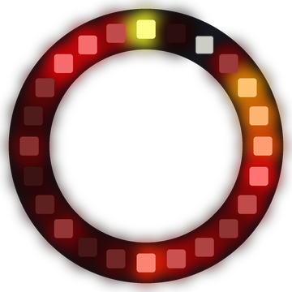

# Lab 20: Ring of Fire

The whole ring flickers with red, orange and yellow flames. This is a **simulation** (a program that copies how something works in the real world). Here, it copies how heat spreads.

!!! tip "Pixel says..."
    
    Things are about to heat up! Let's build a fire that goes all the way around.

**Program file:** [`20-ring-of-fire.py`](https://github.com/dmccreary/moving-rainbow/blob/master/src/kits/ring-24/20-ring-of-fire.py)

{ width="260" }

*Drawn by a ring simulator on a computer, so your real ring may look a little different. On the real ring it moves.*

## What You'll Learn

- Keep a heat number for every pixel in a **list** (a row of values stored under one name)
- Let heat spread to the **neighbors** (the pixels right next to a pixel)
- Use `%` so pixel 23 and pixel 0 are neighbors too
- Turn a number into a color with a function

## What You'll Need

- Your Ring 24 kit plugged into your computer

## The Program

This program spreads the heat, cools it, adds new sparks and then colors each pixel by its heat.

```python
--8<-- "src/kits/ring-24/20-ring-of-fire.py"
```

You should see flames flicker and dance around the whole ring. Bright yellow sparks pop up and fade to orange and dark red.

## How It Works

`heat` is a list of 24 numbers, one for each pixel. A heat of 0 is cold and 255 is the hottest.

Each step, every pixel looks at its two neighbors. The line `(left + heat[i] * 2 + right) // 4` mixes their heat. The pixel's own heat counts twice. Then `randint(0, COOLING)` takes away a random bit of heat. `max(0, ...)` keeps the heat from going below zero.

A ring has no ends. `heat[(i - 1) % NUMBER_PIXELS]` is the left neighbor. For pixel 0, `(0 - 1) % 24` is 23. So pixel 0 and pixel 23 share heat like any other neighbors.

Next, `SPARKS` new sparks land on random pixels. `min(255, ...)` keeps the heat at 255 or less. Last, `heat_to_color()` turns low heat into dark red, middle heat into orange and high heat into yellow.

## Try It Yourself

1. Change `COOLING` to `60` for a weak fire, or `20` for a roaring one.
2. Change `SPARKS` to `1` or `4`. How does the fire change?

## Check Your Understanding

1. What color is the hottest heat?
2. Which pixel is the left neighbor of pixel 0?
3. Why does the fire keep going instead of dying out?

!!! success "Lab complete!"
    
    Great work! Your code is on fire, in the best way.

## What's Next

Go on to [Lab 21: Ring Automaton](21-ring-automaton.md).
