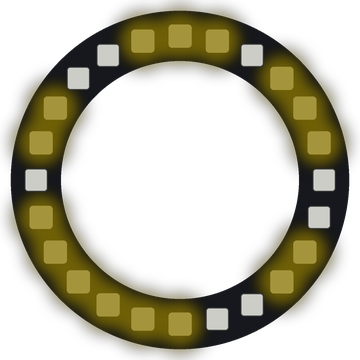

# Lab 21: Ring Automaton

Each pixel is a tiny cell that is on or off. A simple rule decides what every cell does next, and surprising patterns grow around the ring.

!!! tip "Pixel says..."
    
    Tiny rules can make big surprises. Let's see what a few lines of math can grow!

**Program file:** [`21-ring-automaton.py`](https://github.com/dmccreary/moving-rainbow/blob/master/src/kits/ring-24/21-ring-automaton.py)

{ width="260" }

*Drawn by a ring simulator on a computer, so your real ring may look a little different. On the real ring it moves.*

## What You'll Learn

- Build a **cellular automaton** (a row of cells that change by following a rule)
- Make a new **generation** (the next set of on and off cells) from the old one
- Turn three cells into a **binary number** (a number written with only 0s and 1s)
- See why a ring has no **edge cells** (cells with only one neighbor)

## What You'll Need

- Your Ring 24 kit plugged into your computer
- Thonny open so you can see the Shell

## The Program

This program starts with one cell on and builds 80 generations for each rule in the `rules` list.

```python
--8<-- "src/kits/ring-24/21-ring-automaton.py"
```

You should see one pixel light at the top, then a pattern spread out and change with every step. The color slowly shifts, and the Shell prints the rule number each time a new rule starts.

## How It Works

Each cell has a left neighbor and a right neighbor. On a strip, the end cells only have one neighbor. On a ring, `%` wraps around, so every cell always has two. There are no edge cells at all.

The rule works like this. A cell looks at its left neighbor, itself and its right neighbor. `left * 4 + cells[i] * 2 + right` turns those three into a binary number from 0 to 7. For example, off-on-off is `010`, which is 2.

The rule number holds eight answers, one for each of those patterns. Rule 30 in binary is `00011110`. `(rule >> pattern) & 1` picks out one bit of that number. If the bit is 1, the cell turns on in the next generation. If it is 0, the cell turns off.

Each rule runs for `GENERATIONS` steps (80 generations, about 16 seconds). Then the next rule starts with one cell on at the top. If every cell goes out, the program lights the top cell again and keeps going with the same rule.

## Try It Yourself

1. Add rule `4` to the `rules` list. Can you guess what it does before you run it?
2. Change `GENERATIONS` to `30` so you see the rules change faster.

## Check Your Understanding

1. What binary number does on-on-off make, and what is it in normal numbers?
2. Why does every cell on the ring have two neighbors?
3. Which five rules does the program show?

!!! success "Lab complete!"
    
    Amazing! You made tiny rules grow giant patterns.

## What's Next

Go on to [Lab 22: Button Dial](22-button-dial.md).
