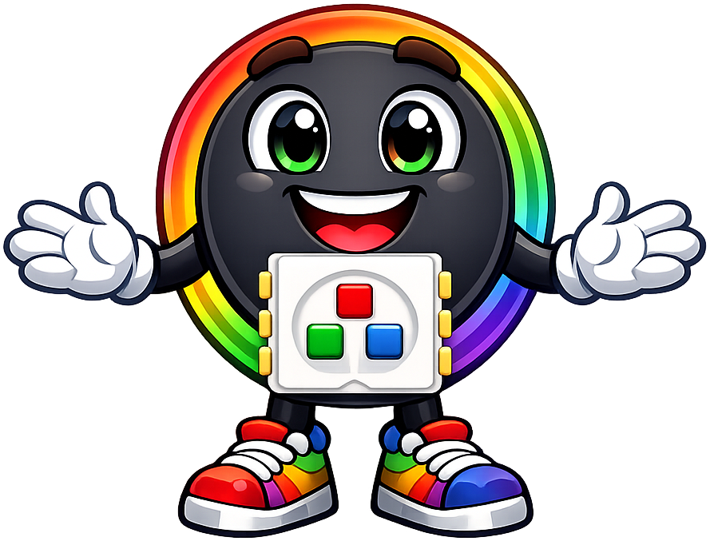
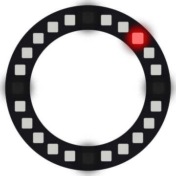

# Lab 22: Button Dial

The two buttons turn the ring like a dial. Button 1 moves a red dot clockwise and Button 2 moves it counter-clockwise.

!!! tip "Pixel says..."
    
    Now you are in control! Press the buttons and turn the dot around the dial.

**Program file:** [`22-button-dial.py`](https://github.com/dmccreary/moving-rainbow/blob/master/src/kits/ring-24/22-button-dial.py)

{ width="260" }

*Drawn by a ring simulator on a computer, so your real ring may look a little different. On the real ring it moves.*

## What You'll Learn

- Use an **interrupt** (code that runs the moment a button is pressed)
- Add a **debounce** (a short wait so one press counts only once)
- Use `%` to wrap from pixel 23 back to 0, and from 0 back to 23
- Turn a pixel number into an **angle** (how far around the circle it is, in degrees)

## What You'll Need

- Your Ring 24 kit with Button 1 on GPIO 15 and Button 2 on GPIO 14
- Thonny open so you can see the Shell

## The Program

This program moves a red dot one step each time you press a button and marks 12, 3, 6 and 9 o'clock.

```python
--8<-- "src/kits/ring-24/22-button-dial.py"
```

You should see a red dot at 12 o'clock and four dim white marks. Each press moves the dot one pixel, and the Shell prints its position and angle.

## How It Works

`button1.irq()` tells the Pico to run `button1_pressed()` the moment the pin falls from 1 to 0. That is an interrupt. The main loop keeps drawing, and the button function jumps in whenever you press.

Buttons "bounce." The metal inside can touch and spring apart a few times in one press, which looks like many presses. `ticks_diff(now, last_press) > DEBOUNCE_MS` ignores any press less than 150 ms after the last one. That is debouncing.

Button 1 does `position + 1` and Button 2 does `position - 1`. The `% NUMBER_PIXELS` wraps both ways. Going up from 23 gives 0, and going down from 0 gives 23.

A full circle is 360 degrees, and the ring has 24 pixels. So each pixel is 15 degrees. `position * 360 // NUMBER_PIXELS` turns the position into an angle.

## Try It Yourself

1. Make each press move the dot two pixels instead of one.
2. Change `red` to a new color, or make the marks brighter.

## Check Your Understanding

1. What is an interrupt?
2. What angle does the Shell print at position 6?
3. Where does the dot go if you press Button 2 at position 0?

!!! success "Lab complete!"
    
    Nice turn! Your ring now listens to both buttons.

## What's Next

Go on to [Lab 23: Speed and Direction](23-speed-and-direction.md).
