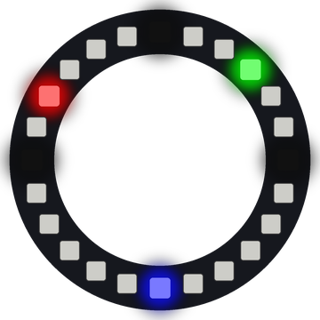

# Lab 24: Ring Clock

The ring becomes a clock face with three colored hands. The hour hand is red, the minute hand is green and the second hand is blue.

!!! tip "Pixel says..."
    
    A ring is the perfect shape for a clock. It's about time we built one!

**Program file:** [`24-ring-clock.py`](https://github.com/dmccreary/moving-rainbow/blob/master/src/kits/ring-24/24-ring-clock.py)

{ width="260" }

*Drawn by a ring simulator on a computer, so your real ring may look a little different. On the real ring it moves.*

## What You'll Learn

- Read the Pico's clock with `time()` (the number of seconds the clock has counted)
- Split seconds into hours, minutes and seconds with `//` and `%`
- Turn a time into a **fraction** (a part of a whole) of the way around the ring
- **Mix** colors by adding their red, green and blue parts

## What You'll Need

- Your Ring 24 kit with Button 1 on GPIO 15 and Button 2 on GPIO 14
- Thonny open so you can see the Shell

## The Program

This program reads the time, works out where each hand goes and draws the three hands.

```python
--8<-- "src/kits/ring-24/24-ring-clock.py"
```

You should see a blue second hand creep around the ring, plus a green minute hand and a red hour hand. Press Button 1 to add an hour and Button 2 to add a minute.

## How It Works

`time()` gives a big count of seconds. `total % 60` is the seconds, `(total // 60) % 60` is the minutes and `(total // 3600) % 12` is the hour. `//` divides and drops the remainder. `%` keeps only the remainder.

The ring has 24 pixels, but a minute has 60 seconds. `second * NUMBER_PIXELS // 60` finds how far around the dial a hand should be. So the blue hand moves one pixel every 2.5 seconds. The hour hand uses minutes too, so it creeps along as the hour goes by.

`draw_hand()` adds a hand's color to whatever is already on that pixel. Where hands overlap, the colors mix. Red and green make yellow, green and blue make cyan, and all three make white. `mix()` keeps each part at 255 or less.

The buttons add to `offset_seconds`. Button 1 adds 3600 seconds (one hour) and Button 2 adds 60 seconds (one minute). Thonny sets the Pico's clock when it connects. On battery power, the clock starts from a fixed time, and you set it with the buttons.

## Try It Yourself

1. Make the dim marks at 12, 3, 6 and 9 o'clock brighter.
2. Change the hand colors. What new colors appear when the hands overlap?

## Check Your Understanding

1. How many seconds are in one hour?
2. What color do you see when the red and green hands overlap?
3. Why does the hour hand use `% 12` instead of `% 24`?

!!! success "Lab complete!"
    
    Right on time! You built a working clock out of light.

## What's Next

Go on to [Lab 25: Prize Wheel](25-prize-wheel.md).
