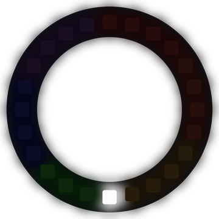

# Lab 25: Prize Wheel

Press a button to spin the wheel. A white pointer races around six colored wedges, slows down and stops on a winner.

!!! tip "Pixel says..."
    
    Step right up and give it a spin! Every color is a winner on this wheel.

**Program file:** [`25-prize-wheel.py`](https://github.com/dmccreary/moving-rainbow/blob/master/src/kits/ring-24/25-prize-wheel.py)

{ width="260" }

*Drawn by a ring simulator on a computer, so your real ring may look a little different. On the real ring it moves.*

## What You'll Learn

- Slow a moving pointer with **friction** (a force that steals a little speed every moment)
- Give a program a **state** (a word that says what it is doing right now)
- Use a random starting speed so the wheel stops in a random place
- Split 24 pixels into 6 equal **wedges** (slices of the circle)

## What You'll Need

- Your Ring 24 kit with Button 1 on GPIO 15 and Button 2 on GPIO 14
- Thonny open so you can see the Shell

## The Program

This program waits for a press, spins the pointer until friction stops it and then flashes the winning wedge.

```python
--8<-- "src/kits/ring-24/25-prize-wheel.py"
```

You should see six dim wedges: red, orange, yellow, green, blue and violet. Press either button, and the white pointer spins, slows and stops. The winning wedge flashes, and the Shell prints its color.

## How It Works

The program is always in one of three states: `'waiting'`, `'spinning'` or `'won'`. The `if` and `elif` lines in the main loop check the state and do the right job for it.

When you press a button, the pointer gets a random speed from 0.7 to 1.3 pixels per step. Every step, `speed = speed * FRICTION` keeps 98.5% of the speed. That is our friction. The pointer slows down a tiny bit each step, so it glides to a gentle stop.

When the speed drops below `STOP_SPEED`, the state changes to `'won'`. `int(pointer) // WEDGE_SIZE` finds the winning wedge. Each wedge is 4 pixels, because 24 divided by 6 is 4. The wedge flashes 8 steps on and 8 steps off, and then the program goes back to `'waiting'`.

Both buttons call the same `button_pressed()` interrupt. A press while the wheel spins or flashes is ignored.

## Try It Yourself

1. Change `FRICTION` to `0.97`. Does the wheel stop sooner or later?
2. Remove two of the colors from `wedges`. Now there are 4 wedges of 6 pixels each.

## Check Your Understanding

1. What are the three states of the prize wheel?
2. What does `FRICTION` do to the speed each step?
3. Why does the wheel stop in a different place each spin?

!!! success "Lab complete!"
    
    And the winner is... you! That was a prize-worthy program.

## What's Next

Go on to [Lab 26: Cyclone Game](26-cyclone-game.md).
