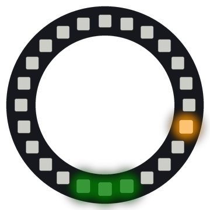

# Lab 26: Cyclone Game

A yellow dot races around the ring. Press a button when the dot is on the green target. Each hit makes the game faster!

!!! tip "Pixel says..."
    
    Game time! How many hits can you score before the dot gets too fast?

**Program file:** [`26-cyclone-game.py`](https://github.com/dmccreary/moving-rainbow/blob/master/src/kits/ring-24/26-cyclone-game.py)

{ width="260" }

*Drawn by a ring simulator on a computer, so your real ring may look a little different. On the real ring it moves.*

## What You'll Learn

- Keep a **score** (a count of your hits) in a variable
- Speed up a game by making the **delay** (the sleep between steps) shorter after each hit
- Find the shortest **ring distance** (the fewest steps between two pixels, going either way)
- Make the game harder by shrinking the target

## What You'll Need

- Your Ring 24 kit with Button 1 on GPIO 15 and Button 2 on GPIO 14
- Thonny open so you can see the Shell

## The Program

This program moves the dot one step at a time and checks for a hit or a miss each time you press a button.

```python
--8<-- "src/kits/ring-24/26-cyclone-game.py"
```

You should see a yellow dot circle the ring and a green target at 6 o'clock. A hit flashes the ring green. A miss flashes it red three times and then shows your score.

## How It Works

Both buttons call `button_pressed()`, which sets `button_was_pressed` to `True`. The main loop checks it. `ring_distance(position, target)` counts the fewest steps between the dot and the target. Going one way or the other around the ring, it picks the shorter path.

At first, the target is 3 pixels wide, so `reach` is 1. A hit counts if the dot is 1 step away or less. After `SMALL_TARGET_SCORE` (5) hits, `reach` becomes 0 and the target shrinks to one pixel.

Each hit moves the target to a random pixel. It also does `delay * SPEED_UP`. `SPEED_UP` is 0.88, so the delay gets 12% shorter and the dot gets faster. `max(..., FASTEST_DELAY)` stops it from going faster than 0.015 seconds per step. That game speed-up keeps the challenge growing as you get better.

A miss shows your score as yellow pixels, counted clockwise from 12 o'clock. Then a new game starts at the first speed.

## Try It Yourself

1. Change `SPEED_UP` to `0.8` for a game that gets fast in a hurry.
2. Change `SMALL_TARGET_SCORE` to `10` to keep the big target longer.

## Check Your Understanding

1. How wide is the target at the start of a game?
2. What does `SPEED_UP` do to the delay after each hit?
3. How does the game show your final score?

!!! success "Lab complete!"
    
    High score! You built a real arcade game on a ring of lights.

## What's Next

Go on to [Lab 27: Main Template](27-main-template.md).
