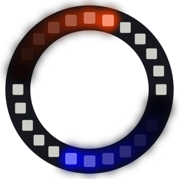

# Lab 27: Main Template

This program puts sixteen patterns from Labs 5 to 21 into one light show. Mode 0 changes the pattern every 10 seconds by itself. Button 1 moves to the next mode and Button 2 moves back.

!!! tip "Pixel says..."
    
    This is the grand finale! Everything you built comes together in one ring of light.

**Program file:** [`27-main-template.py`](https://github.com/dmccreary/moving-rainbow/blob/master/src/kits/ring-24/27-main-template.py)

{ width="260" }

*Drawn by a ring simulator on a computer, so your real ring may look a little different. On the real ring it moves.*

## What You'll Learn

- Turn each pattern into a **draw function** (a function that draws one step and then returns)
- Use an **interrupt** (code that runs the moment a button is pressed) for each button
- Add a **debounce** so one press counts once
- Run the program on its own as `main.py`

## What You'll Need

- Your Ring 24 kit with Button 1 on GPIO 15 and Button 2 on GPIO 14
- All the lab files uploaded with `./upload-code.sh`

## The Program

This program draws one step of the current pattern, writes the ring and checks the mode again.

```python
--8<-- "src/kits/ring-24/27-main-template.py"
```

The ring starts in auto mode and shows a new pattern every 10 seconds. Press Button 1 or Button 2 to pick one pattern.

## The Modes

| Mode | Pattern | From |
|------|---------|------|
| 0 | Auto: a new pattern every 10 seconds | |
| 1 | Spin a Dot | [Lab 5](05-spin-dot.md) |
| 2 | Comet | [Lab 6](06-comet.md) |
| 3 | Two Comets | [Lab 7](07-two-comets.md) |
| 4 | Meet and Flash | [Lab 8](08-meet-and-flash.md) |
| 5 | Spinning Rainbow | [Lab 10](10-spinning-rainbow.md) |
| 6 | Pinwheel | [Lab 11](11-pinwheel.md) |
| 7 | Loading Spinner | [Lab 12](12-loading-spinner.md) |
| 8 | Breathing Halo | [Lab 13](13-breathing-halo.md) |
| 9 | Sine Wave | [Lab 14](14-sine-wave.md) |
| 10 | Ripples | [Lab 15](15-ripple.md) |
| 11 | Radar | [Lab 16](16-radar.md) |
| 12 | Planets | [Lab 17](17-planets.md) |
| 13 | Pendulum | [Lab 18](18-pendulum.md) |
| 14 | Water Level | [Lab 19](19-water-level.md) |
| 15 | Ring of Fire | [Lab 20](20-ring-of-fire.md) |
| 16 | Ring Automaton | [Lab 21](21-ring-automaton.md) |

The Color Wheel from [Lab 9](09-color-wheel.md) is a still picture, so it is left out. The Spinning Rainbow in mode 5 is the same wheel, turning.

## How It Works

Each pattern is a draw function that sets the colors for one step and returns. The main loop calls it, writes the ring and sleeps. No pattern runs a long loop of its own, so the program sees a button press right away.

The `patterns` list holds a name, a draw function and a delay for every pattern. Mode 1 is `patterns[0]`, mode 2 is `patterns[1]` and so on.

`button1.irq()` and `button2.irq()` tell the Pico to run a function the moment a pin falls to 0. Button 1 adds 1 to `mode` and Button 2 takes 1 away. `% MODE_COUNT` wraps around, so the next mode after 16 is 0, and the mode before 0 is 16. Each function ignores presses less than 250 ms apart. Buttons "bounce" and can look like many presses.

In mode 0, the loop checks the clock. After `AUTO_MS` (10,000 ms), it moves to the next pattern.

The Pico runs `main.py` by itself when it gets power. Save a copy of this file on the Pico as `main.py`, and your ring starts the show with no computer attached:

```bash
mpremote cp 27-main-template.py :main.py
```

## Try It Yourself

1. Change `AUTO_MS` to `5000` for faster auto mode.
2. Change the delay for one pattern in the `patterns` list. Make your favorite pattern faster or slower.

## Check Your Understanding

1. Why does each draw function only draw one step?
2. What mode comes after mode 16 when you press Button 1?
3. What file name does the Pico run by itself?

!!! success "Lab complete!"
    
    You built a whole light show on a ring! Now go share it with someone.

## What's Next

Add your own pattern: write a `draw_` function that draws one step, and add a line for it to the `patterns` list. You can also go back to the [kit page](index.md).
