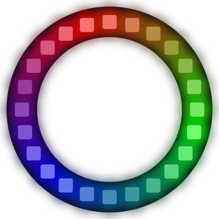
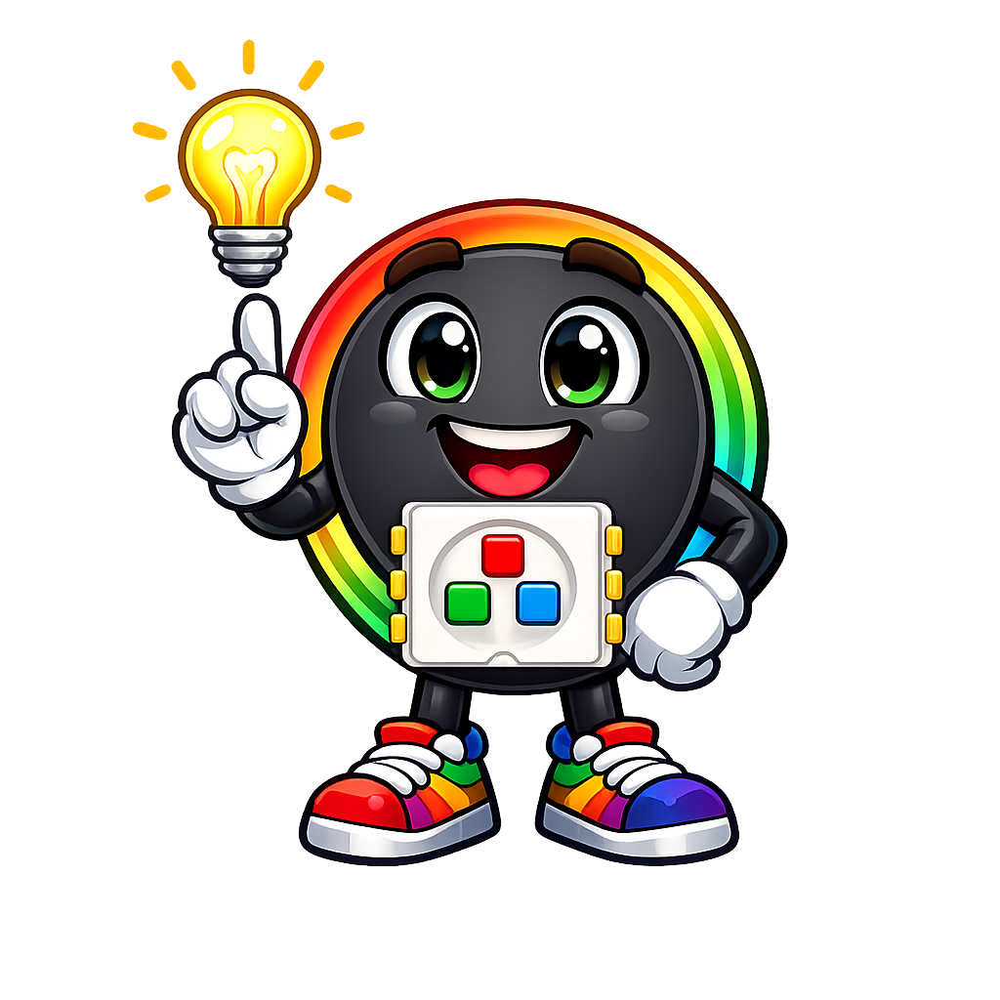
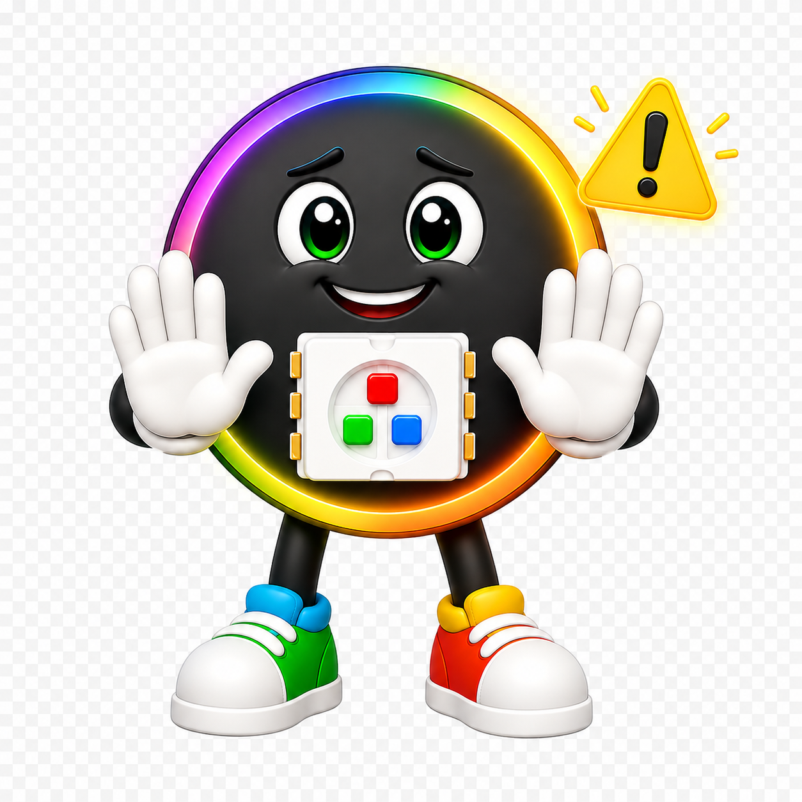
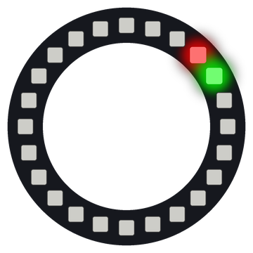
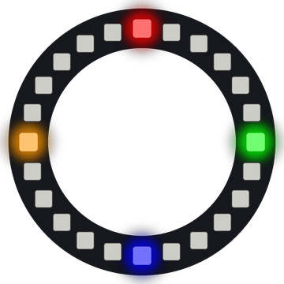
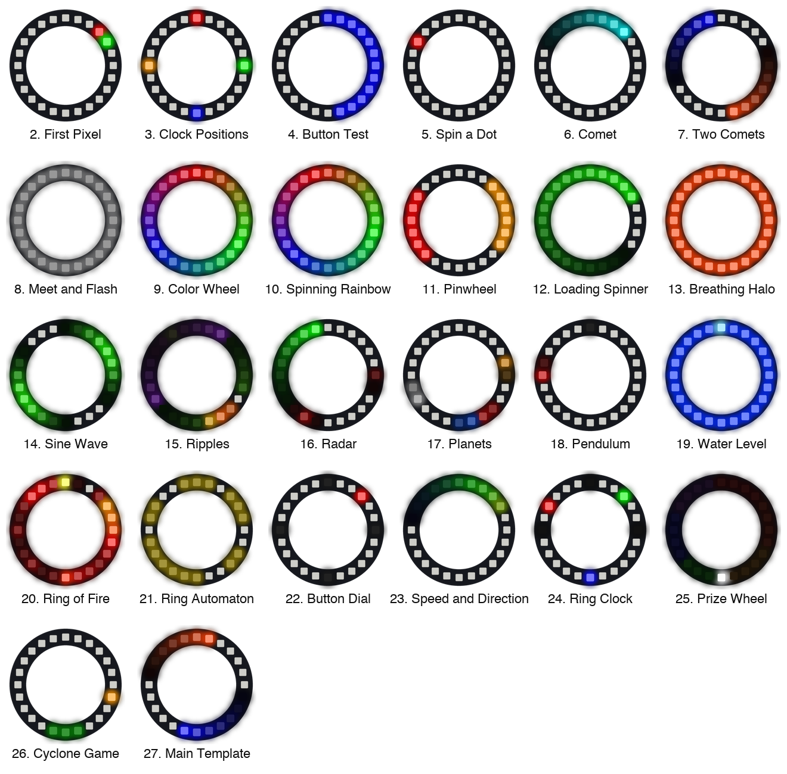
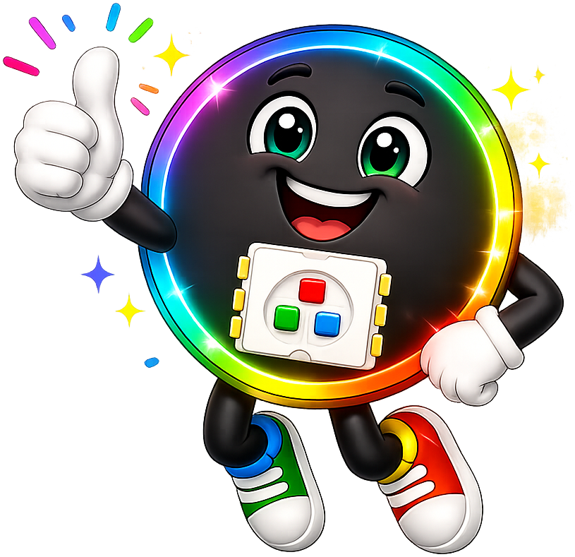
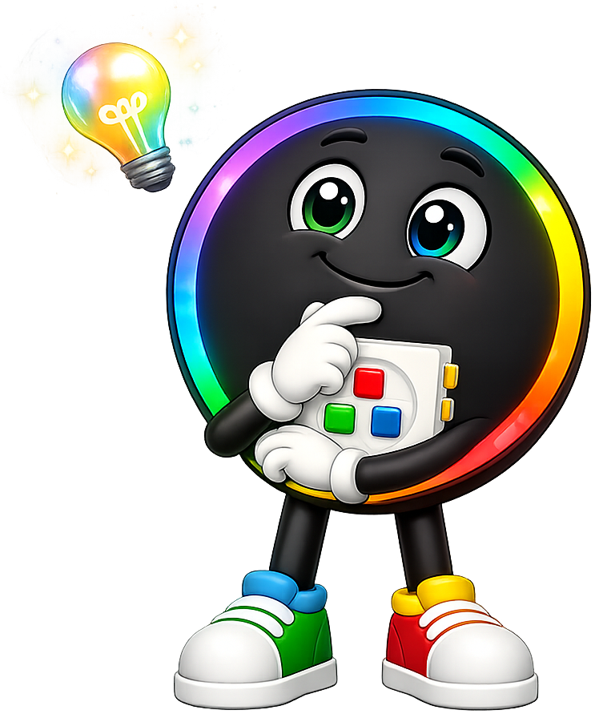
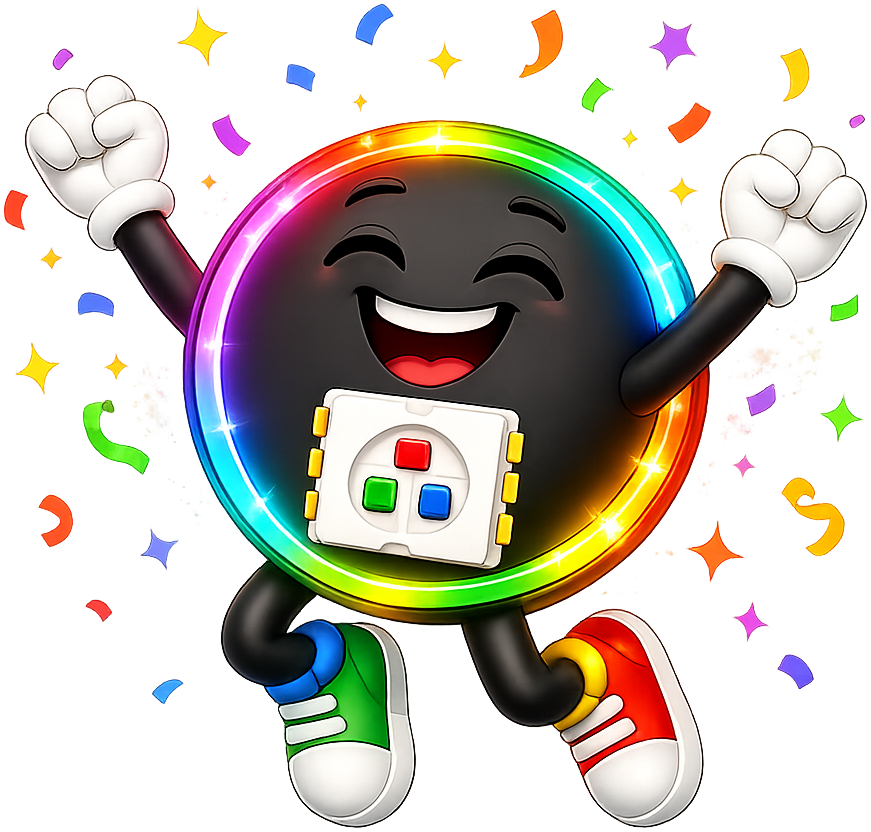

# Ring 24 Kit: Make a Circle of Light Spin, Glow and Play

{ width="360" }

*A ring of 24 color lights, a Raspberry Pi Pico and two buttons. This picture was drawn by a ring simulator on a computer, so your real ring may look a little different.*

!!! mascot-welcome "Welcome to the Ring 24 Kit"
    { class="mascot-admonition-img" }
    A ring of lights has no ends, so it's perfect for spinners, clocks, planets and games. You'll run 27 programs, from one blinking light to a prize wheel. Let's light this up!

## What You Will Learn

After this lesson you will be able to:

1. Wire a ring of lights and two buttons to a Raspberry Pi Pico.
2. Test each part on its own before you put them together.
3. Use the **remainder** (`%`) to make a light wrap from the last pixel back to the first.
4. Turn a clock position or an angle into a pixel number.
5. Read a short program and explain what it does.
6. Change one setting and predict what will happen.
7. Put many patterns into one program that you switch with buttons.

## Lesson at a Glance

| Item | Details |
|------|---------|
| Grade level | 6th grade (about age 11) |
| Time needed | About 90 minutes for Steps 1 to 6. Two 45-minute periods works well |
| Difficulty | Beginner |
| The big idea | A circle has no ends, so the math of going around (remainders, angles, clock faces) shows up as light you can see |
| You should already know | How to run a program in Thonny. See [Chapter 5: Pico Hardware](../../chapters/05-raspberry-pi-pico-hardware/index.md) |
| New ideas in this lesson | pixel numbers, remainder (`%`), clock positions, angles, color wheel, brightness, interrupts |
| Help you need | A grown-up helper for the upload step |

## Meet Your Parts

| Part | What it does | Think of it like |
|------|--------------|------------------|
| Raspberry Pi Pico | A tiny computer that runs your MicroPython programs | The brain of the kit |
| 24-pixel NeoPixel ring | 24 color lights in a circle. Each light is a **pixel** (one dot of light that can be any color) | A clock face made of lights |
| Two push buttons | Each one connects a Pico pin to ground while you hold it down | A doorbell: it only counts while you press it |
| Jumper wires | Carry power and signals between the parts | Roads between towns |
| USB cable | **USB** (Universal Serial Bus) brings power from the computer and carries your code | A power cord and a mail truck in one |

### Why a Ring?

A strip of lights has a start and an end. When a moving dot gets to the end, your code has to decide what to do. A ring is different. Pixel 23 sits right next to pixel 0, so a dot can keep going around forever.

That one change makes a lot of new patterns possible. A ring can be a clock, a radar screen, a prize wheel or a planet's orbit. It also turns math into something you can watch. Simple division tells you exactly which light turns on.

### How the Pixels Are Numbered

The pixels are numbered 0 to 23, going clockwise. On this kit, pixel 0 sits at about 1:30 on a clock face. So the pixel at 12 o'clock is number 21.

That number is saved in `config.py` as `TOP_PIXEL`. Many labs count **positions** (steps clockwise from the top) instead of pixel numbers. Position 0 is 12 o'clock, 6 is 3 o'clock, 12 is 6 o'clock and 18 is 9 o'clock.

## Parts You Need

| Part | Notes |
|------|-------|
| Raspberry Pi Pico | With headers, so it can sit in a breadboard |
| 24-pixel WS2812B ring | Any ring sold as "NeoPixel" or "WS2812B" with 24 pixels works |
| Two push buttons | The small four-legged kind that fits across the middle of a breadboard |
| Breadboard | A half-size board is big enough |
| Jumper wires | Male-to-male for the breadboard; male-to-female if your ring has pins instead of wires |
| USB cable | One that carries data. Some cables only charge |

## Step 1: Wire the Ring and the Buttons

The Pico has pin numbers printed next to each pin. Names like **GP0** mean "general purpose pin 0", a pin your code can control. **VBUS** is the 5 volts that comes in on the USB cable. **GND** (ground) is the shared return path for every part.

!!! mascot-tip "Pixel's Tip"
    { class="mascot-admonition-img" }
    Pin 1 is the corner pin next to the USB plug. Count down that side to pin 20, then come back up the other side from pin 21 to pin 40.

1. Unplug the Pico from the USB cable. Never wire a board that has power.
2. Push the Pico into the breadboard so it sits across the middle gap.
3. Connect the ring's **DI** pad (data in, sometimes printed DIN) to Pico **pin 1 (GP0)**.
4. Connect the ring's **5V** pad to Pico **pin 40 (VBUS)**.
5. Connect the ring's **GND** pad to Pico **pin 38 (GND)**.
6. Connect Pico **pin 18 (GND)** to the blue ground rail on the edge of the breadboard.
7. Push Button 1 across the middle gap. Wire one leg to Pico **pin 20 (GP15)** and the other leg to the ground rail.
8. Push Button 2 across the middle gap. Wire one leg to Pico **pin 19 (GP14)** and the other leg to the ground rail.

| From | Pico pin | Pico name | What it does |
|------|----------|-----------|--------------|
| Ring DI | 1 | GP0 | Sends the colors to the ring |
| Ring 5V | 40 | VBUS | Power for the ring, straight from USB |
| Ring GND | 38 | GND | The shared return path |
| Button 1 | 20 | GP15 | The Pico reads Button 1 here |
| Button 2 | 19 | GP14 | The Pico reads Button 2 here |
| Ground rail | 18 | GND | Both buttons' other legs go here |


Follow the colors: **red** wires carry *power*, **amber** wires carry *data and button signals*, and **black** wires are *ground*. A dot means two wires are connected.

The buttons need no extra parts. The code turns on the Pico's **pull-up resistor**. It's a part inside the chip that holds the pin at 1, like a spring holding a door shut. The pin reads 1 when the button is up and 0 while you press it.

!!! mascot-warning "Watch Out!"
    { class="mascot-admonition-img" }
    Your ring has two data pads: **DI** (data in) and **DO** (data out). The Pico must connect to **DI**. If nothing lights up, check this pad first.

## Step 2: Put the Code on the Pico

To **upload** means to copy files from your computer onto the Pico. A grown-up helper can run the upload script from the kit folder. Close Thonny first, because only one program can use the Pico at a time.

```bash
cd src/kits/ring-24      # go to the kit folder
./upload-code.sh         # copy config.py and all 27 labs onto the Pico
```

The script copies 28 files: `config.py` plus the 27 numbered labs. It skips `circuit-diagram.py`, which draws the wiring picture on a computer. You can also open each lab in Thonny and save it to the Pico with the same name.

## Step 3: Test Each Part

Test one part at a time. If something fails later, you'll already know which parts are fine.

Run [Lab 1: Blink the Onboard LED](01-blink-onboard-led.md). It needs no wiring at all.

**Checkpoint 1:** Does the small green light next to the USB plug blink?

Run [Lab 2: First Pixel](02-first-pixel.md). Pixel 0 blinks red and pixel 1 stays green.

{ width="240" }

**Checkpoint 2:** Is the red light at about 1:30, with the green one just after it going clockwise? Then the ring is wired right, and you know which way the numbers go.

Run [Lab 3: Clock Positions](03-clock-positions.md). It marks 12, 3, 6 and 9 o'clock and prints this in the Shell:

```
12 o'clock is pixel 21
 3 o'clock is pixel 3
 6 o'clock is pixel 9
 9 o'clock is pixel 15
```

{ width="240" }

**Checkpoint 3:** Is red at the top? If your ring is turned a different way, change `TOP_PIXEL` in `config.py` until it is (see Step 8).

Run [Lab 4: Button Test](04-button-test.md). Hold Button 1 and the right half of the ring turns blue. Hold Button 2 and the left half turns yellow. The Shell prints a line each time a button changes, like this one for pressing Button 1:

```
Button 1: 0  Button 2: 1
```

**Checkpoint 4:** Does each button light its own half? A 0 means pressed and a 1 means up.

## Step 4: Watch the Patterns

Now work through the labs in order. Each one adds one new idea, and each lab page explains its code.



*One moment from each lab, drawn by a ring simulator. On the real ring, every one of them moves.*

| Labs | Section | What you'll make |
|------|---------|------------------|
| 1 to 4 | First steps | Test the Pico, the ring and the buttons |
| 5 to 8 | Going around | [A spinning dot](05-spin-dot.md), [a comet](06-comet.md), [two comets](07-two-comets.md) and [dots that meet](08-meet-and-flash.md) |
| 9 to 13 | Color | [A color wheel](09-color-wheel.md), [a spinning rainbow](10-spinning-rainbow.md), [a pinwheel](11-pinwheel.md), [a loading spinner](12-loading-spinner.md) and [a breathing halo](13-breathing-halo.md) |
| 14 to 21 | Math and motion | [Sine waves](14-sine-wave.md), [ripples](15-ripple.md), [radar](16-radar.md), [planets](17-planets.md), [a pendulum](18-pendulum.md), [water](19-water-level.md), [fire](20-ring-of-fire.md) and [a cellular automaton](21-ring-automaton.md) |
| 22 to 24 | Buttons | [A dial](22-button-dial.md), [speed and direction](23-speed-and-direction.md) and [a clock](24-ring-clock.md) |
| 25 to 26 | Games | [A prize wheel](25-prize-wheel.md) and [the Cyclone game](26-cyclone-game.md) |
| 27 | Put it together | [All the patterns in one program](27-main-template.md) |

## Step 5: Make It Stand Alone

The Pico runs a file named `main.py` by itself whenever it gets power. Lab 27 holds 16 patterns from Labs 5 to 21. Button 1 picks the next one, and Button 2 goes back.

1. Stop any program that is running in Thonny.
2. Close Thonny.
3. Save Lab 27 on the Pico with the name `main.py`:

    ```bash
    mpremote cp 27-main-template.py :main.py    # the colon means "on the Pico"
    ```

4. Unplug the USB cable.
5. Plug the Pico into a phone charger.
6. Watch the light show start by itself.

## Step 6: Math Time

The ring turns math into light. Make a prediction before you run each program, then check it.

| Question | Your prediction | What happens | Why |
|----------|-----------------|--------------|-----|
| In Lab 5, what pixel comes after 23? | | Pixel 0 | `24 % 24` is 0. The remainder wraps the dot around |
| How many degrees apart are two neighbor pixels? | | 15 degrees | 360 degrees ÷ 24 pixels = 15 |
| In Lab 11, can a pinwheel have 8 blades? | | It shows a seam | 8 blades plus 8 gaps make 16 parts, and 24 does not divide evenly by 16 |
| In Lab 3, which pixel is at 3 o'clock? | | Pixel 3 | Position 6 plus `TOP_PIXEL` 21 is 27, and `27 % 24` is 3 |

## Step 7: How the Code Works

!!! mascot-encourage "You Can Do This!"
    { class="mascot-admonition-img" }
    Reading code is like learning a new language. It feels slow at first, and that's normal. We'll take it one small piece at a time.

### Piece 1: Turning the Brightness Down

Every lab has this small **function** (a named block of code you can use again and again):

```python
# return a color scaled by a number from 0.0 (off) to 1.0 (full),
# and also by BRIGHTNESS so the ring is comfortable to look at
def fade(color, amount):
    scale = amount * BRIGHTNESS      # BRIGHTNESS is 0.25 in config.py
    return (int(color[0] * scale), int(color[1] * scale), int(color[2] * scale))
```

A color is three numbers: red, green and blue, each from 0 to 255. `fade((255, 0, 0), 1)` gives back `(63, 0, 0)`, because 255 × 0.25 is 63.75 and `int()` drops the part after the decimal point.

Why turn it down? Each pixel holds three tiny lights. At full power, each one uses about 20 milliamps (mA, a small amount of electric current):

\[
24 \times 3 \times 20 \text{ mA} = 1440 \text{ mA}
\]

A USB port gives about 500 mA. At a quarter of the brightness, the brightest lab (Lab 13) uses only about 240 mA.

### Piece 2: Counting Around the Circle

```python
# turn a position counted clockwise from the top into a pixel number
def pixel_at(position):
    return (TOP_PIXEL + position) % NUMBER_PIXELS
```

The `%` sign gives the **remainder**, what is left over after you divide. Here is position 6 (3 o'clock) worked out:

1. `TOP_PIXEL + position` is 21 + 6 = 27.
2. 27 ÷ 24 is 1, with 3 left over.
3. So `27 % 24` is 3, and pixel 3 lights up.

!!! mascot-thinking "Pixel Thinks..."
    { class="mascot-admonition-img" }
    The remainder is the secret of every ring pattern. However big the number gets, `% 24` always gives back a pixel from 0 to 23. It even works going backward: `-1 % 24` is 23.

### Piece 3: A Color for Every Angle

Lab 9 gives each position its own color, all the way around the wheel:

```python
for position in range(NUMBER_PIXELS):
    angle = position * 360 // NUMBER_PIXELS       # 0, 15, 30 ... 345 degrees
    color = wheel(position * 256 // NUMBER_PIXELS)  # 0 to 255 picks a color
    strip[pixel_at(position)] = fade(color, 1)
strip.write()                                      # show all 24 colors at once
```

`wheel()` turns a number from 0 to 255 into a color: red, then green, then blue, then back to red. Position 0 gets 0 (red). Position 6 (3 o'clock) gets 6 × 256 ÷ 24 = 64, which the Shell shows as `(63, 192, 0)`, a yellow-green.

### Piece 4: One Step at a Time

Lab 27 holds 16 patterns. Each one is a draw function that sets the colors for one step and then stops:

```python
# Lab 05: one dot goes around
def draw_spin_dot(step):
    strip.fill(off)                            # clear every pixel in memory
    strip[step % NUMBER_PIXELS] = fade(red, 1) # light just one
```

The main loop calls the draw function, then `strip.write()`, then `sleep()`. No pattern runs a long loop of its own. So when you press a button, the very next step can switch patterns.

The buttons use an **interrupt**: code that runs the moment a pin changes, even in the middle of something else. A press also "bounces" and can look like many presses, so the code ignores presses that come too close together. That is called **debouncing**.

## Step 8: Change a Setting

Try changing one number in `config.py`.

1. Open `config.py` on the Pico in Thonny.
2. Find `TOP_PIXEL = 21`.
3. **Predict first:** if you change it to `9`, where will Lab 3's red light go?
4. Change it, save the file and run Lab 3 again.
5. Change it back to `21` when you're done.

Red moves to the bottom, at pixel 9. Now every lab that uses `pixel_at()` thinks the ring is upside down! If you run the upload script again, it copies the kit's own `config.py` over yours, so your change goes away.

## Challenges

Try these from easy to hard. Each one has been tested on a ring simulator.

1. **Backward dot.** In Lab 5, make the dot go counter-clockwise. *Hint:* in the last line of the loop, change `+ 1` to `- 1`. Why does the dot go from pixel 0 to pixel 23?
2. **Three comets.** In Lab 7, add a green comet so three comets chase each other. *Hint:* make `THIRD = NUMBER_PIXELS // 3` and start the comets at `position`, `position + THIRD` and `position + 2 * THIRD`. Set `TAIL_LENGTH` to 6 so the tails have room.
3. **Your own pattern.** In Lab 27, write a function called `draw_two_halves(step)`. It lights the right half red for 10 steps, then the left half blue for 10 steps. Add the line `("two halves", draw_two_halves, 0.05),` at the end of the `patterns` list. *Hint:* `(step // 10) % 2` is 0 for 10 steps, then 1 for 10 steps. Your pattern becomes mode 17, one press of Button 2 from mode 0.

## Troubleshooting

| What you see | What to try |
|--------------|-------------|
| No lights at all | Check that the data wire goes to **DI**, not DO. Check the 5V and GND wires |
| The Shell says `ImportError: no module named 'config'` | Save `config.py` on the Pico, not only on your computer |
| Red in Lab 3 is not at the top | Change `TOP_PIXEL` in `config.py` (Step 8) |
| The patterns go the wrong way around | Some rings number their pixels counter-clockwise. Run Lab 2 to check which way yours counts, then ask your teacher |
| A button does nothing | Check that its other leg goes to the ground rail, and that pin 18 goes to the rail |
| One press skips two modes | A loose wire can bounce. Push the button wires in firmly |
| The upload script says no Pico was found | Close Thonny, then try a different USB cable |
| The lights flicker or the Pico restarts | Keep `BRIGHTNESS` at 0.25. A brighter ring can pull too much power from USB |

## Check Your Understanding

??? question "1. What is `30 % 24`? (Click to reveal the answer)"
    6. 30 ÷ 24 is 1, with 6 left over.

??? question "2. How many degrees apart are two neighbor pixels on the ring? (Click to reveal the answer)"
    15 degrees. A full circle is 360 degrees, and 360 ÷ 24 = 15.

??? question "3. `TOP_PIXEL` is 21. Which pixel is at 9 o'clock, position 18? (Click to reveal the answer)"
    Pixel 15. 21 + 18 = 39, and 39 ÷ 24 is 1 with 15 left over.

??? question "4. What does `fade((0, 255, 0), 1)` return when `BRIGHTNESS` is 0.25? (Click to reveal the answer)"
    `(0, 63, 0)`. 255 × 0.25 = 63.75, and `int()` drops the .75.

??? question "5. Why does every lab multiply its colors by `BRIGHTNESS`? (Click to reveal the answer)"
    All 24 pixels at full white would need about 1440 mA. A USB port gives about 500 mA, so a quarter of the brightness keeps the ring safe and still bright.

??? question "6. Why does each pattern in Lab 27 draw only one step at a time? (Click to reveal the answer)"
    So the main loop comes back around after every step. Then a button press can switch patterns right away.

??? question "7. What file name does the Pico run by itself when it gets power? (Click to reveal the answer)"
    `main.py`.

## Words to Know

| Word | What it means |
|------|---------------|
| Pixel | One dot of light that can be any color. The ring has 24 |
| Position | Steps clockwise from 12 o'clock. Position 0 is the top |
| Remainder (`%`) | What is left over after you divide. `27 % 24` is 3 |
| Angle | How far around a circle you turn, in degrees. A full turn is 360 |
| Function | A named block of code you can use again and again |
| Brightness | How strong the light is. Here, a number from 0 to 1 that every color is multiplied by |
| Pull-up resistor | A part inside the Pico that holds a pin at 1 until a button pulls it to 0 |
| Interrupt | Code that runs the moment a pin changes |
| Debouncing | Ignoring the extra "presses" a button makes when its contacts bounce |
| Upload | Copy files from your computer onto the Pico |
| Milliamp (mA) | A small amount of electric current. 1000 mA is one amp |

!!! mascot-celebration "Great Work, Light-Maker!"
    { class="mascot-admonition-img" }
    You turned a circle of 24 lights into clocks, planets, waves and games! Next, invent your own pattern and add it to Lab 27 for everyone to see.

## For Teachers

### Two-Period Plan

| Period | Time | Activity |
|--------|------|----------|
| 1 | 5 min | Hook: show Lab 27 running on a finished ring |
| 1 | 20 min | Step 1: wiring, with a check of every DI wire before power goes on |
| 1 | 20 min | Steps 2 and 3: upload and Checkpoints 1 to 4 |
| 2 | 10 min | Step 6: Math Time predictions as a whole class |
| 2 | 25 min | Step 4: students choose labs from 5 to 21 and read the code |
| 2 | 10 min | Step 5: save Lab 27 as `main.py` and share the rings |

Labs 22 to 26 (buttons and games) and the Challenges fit a third period or a club meeting.

### Before Class

1. Install `mpremote` on the classroom computers (`pip install mpremote`).
2. Test-upload one Pico with `./upload-code.sh` and run Lab 3 to check `TOP_PIXEL`.
3. Pre-load the other Picos, so students can start at Step 3.
4. Check that your jumper wires fit the ring's pads or pins.

### Common Trouble Spots

- The data wire goes to DO instead of DI, and nothing lights up.
- A ring mounted at a different angle needs a new `TOP_PIXEL`. Lab 3 finds it.
- Some labs count from pixel 0 (Labs 2, 5, 6, 7 and 10), so their patterns start at about 1:30, not at the top.
- When `main.py` is running, Thonny can look stuck. Press Stop, or unplug and plug in again.
- Loose button wires look like extra presses.

### Check for Understanding

Ask: "If the ring had 30 pixels instead of 24, what would you change, and which pixel would come after 29?" A good answer: only `NUMBER_PIXELS` in `config.py`, and pixel 0, because `30 % 30` is 0.

## Source Code

The whole kit lives in one folder, [`src/kits/ring-24/`](https://github.com/dmccreary/moving-rainbow/tree/master/src/kits/ring-24):

| File | What it does |
|------|--------------|
| `config.py` | Every pin number and setting, in one place |
| `01-blink-onboard-led.py` to `27-main-template.py` | The 27 labs. Each one has its own page, linked in Step 4 |
| `upload-code.sh` | Copies `config.py` and the labs onto the Pico |
| `circuit-diagram.py` | Draws the wiring picture on a computer (not for the Pico) |
| `README.md` | Notes for whoever builds and keeps up the kit |

## References

1. [MicroPython `neopixel` module](https://docs.micropython.org/en/latest/library/neopixel.html) - MicroPython - the library every lab uses to set pixel colors.
2. [Raspberry Pi Pico Datasheet](https://datasheets.raspberrypi.com/pico/pico-datasheet.pdf) - Raspberry Pi Ltd - the pin map, including VBUS and the GND pins.
3. [Adafruit NeoPixel Überguide](https://learn.adafruit.com/adafruit-neopixel-uberguide) - Adafruit - wiring and power tips for WS2812B rings.
4. [WS2812B Datasheet](https://cdn-shop.adafruit.com/datasheets/WS2812B.pdf) - Worldsemi - how each pixel reads its color and passes the rest along.
5. [Modular Arithmetic](https://en.wikipedia.org/wiki/Modular_arithmetic) - Wikipedia - the "clock math" behind `%`.
